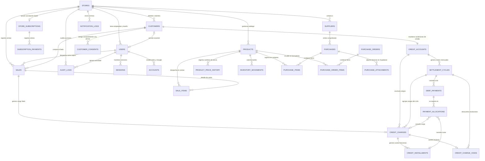

# Quina - Esquema de base de datos relacional PostgreSQL

Este documento especifica el modelo entidad-relación y el esquema físico DDL
completo para la base de datos PostgreSQL de **Quina** sobre Supabase.
Implementa aislamiento multi-inquilino (*multi-tenant*), seguridad a nivel de
fila (*Row Level Security - RLS*), tipos de datos numéricos exactos para
cálculos financieros, autenticación con **Better Auth** y trazabilidad
inmutable mediante kardex, bitácora de auditoría y registro de notificaciones.

Para consultar la arquitectura general de la aplicación, revisa la
[documentación de la webapp](quina-webapp-documentation.md).

---

## 1. Principios de diseño de base de datos

El diseño del esquema sigue las mejores prácticas de ingeniería de datos y los
estándares de la industria para sistemas financieros y comerciales:

1. **Aislamiento multi-inquilino (*Multi-tenancy*):** cada tabla operativa
   incluye la columna `store_id UUID NOT NULL` como clave foránea con
   restricción estricta (`ON DELETE RESTRICT`), **incluidas las tablas de
   detalle** (`sale_items`, `purchase_items`, `purchase_order_items`,
   `payment_allocations`). Las políticas de RLS garantizan que ningún comercio
   pueda leer o alterar datos de otro comercio.
2. **Identificadores universales (UUID):** las claves primarias utilizan `UUID`
   generado mediante `gen_random_uuid()`, evitando la exposición de
   identificadores secuenciales en URLs y APIs públicas. Better Auth se
   configura para generar también UUID en sus tablas.
3. **Precisión numérica exacta para finanzas:**
   - Montos monetarios y saldos: `NUMERIC(12, 2)` con validación `CHECK (amount >= 0)`
     para evitar desbordamientos de coma flotante y representar importes hasta
     S/ 9,999,999,999.99.
   - Cantidades de inventario: `NUMERIC(10, 3)` para admitir fracciones de tres
     decimales (kilos, gramos, litros).
   - Tasas de interés nominales y efectivas: `NUMERIC(7, 4)` (ejemplo: `0.0500`
     representa 5.0000 % o tasa mensual de 0.001667).
4. **Marcas de tiempo con zona horaria:** todas las columnas temporales utilizan
   `TIMESTAMPTZ` normalizado en tiempo universal coordinado (UTC). Los procesos
   de corte y recordatorios se calculan en la zona horaria `America/Lima`.
5. **Inmutabilidad contable y financiera:** los registros de ventas, pagos,
   asignaciones de pago, movimientos de kardex, historial de precios,
   consentimientos, anulaciones de cargos y auditoría no se actualizan ni se
   eliminan. Un trigger (`forbid_mutation`) lo impone en la base de datos;
   cualquier corrección operativa se asienta mediante transacciones de ajuste
   (por ejemplo, un cargo fiado se anula con una fila en `credit_charge_voids`).
6. **Condiciones de crédito congeladas por cargo:** cada cargo fiado guarda una
   copia de las tasas vigentes al momento de la compra. Si el comerciante cambia
   las condiciones de un vecino, solo afectan a las compras futuras.
7. **Estrategia de indexación compuesta:** se configuran índices compuestos
   encabezados por `store_id` para garantizar tiempos de respuesta inferiores a
   5 milisegundos en el plan gratuito de Supabase.

---

## 2. Diagrama entidad-relación (ERD)

El siguiente diagrama ilustra las entidades principales y sus relaciones a
través de los Bounded Contexts de Quina:



---

## 3. Diccionario de datos y especificación de tablas

El esquema tiene **35 tablas**, divididas por dominio de negocio. Las tablas
marcadas como *de plataforma* no pertenecen a ninguna tienda (no llevan
`store_id`) y solo las modifica el Administrador de Plataforma.

### 3.1. Dominio de Identidad, Tienda y Seguridad

Este módulo gestiona los comercios (*tenants*), su suscripción, el control de
acceso basado en roles (RBAC) y las tablas que exige **Better Auth**: usuarios,
sesiones, cuentas (contraseña y Google), verificaciones (OTP, enlaces mágicos
y recuperación de contraseña) y límites de tasa.

#### Tabla `stores`
Almacena los datos fiscales, comerciales y de cobro de cada tienda registrada.

| Columna | Tipo | Restricciones | Descripción |
| :--- | :--- | :--- | :--- |
| `id` | UUID | PK, DEFAULT `gen_random_uuid()` | Identificador único de la tienda. |
| `commercial_name` | VARCHAR(150) | NOT NULL | Nombre comercial visible (ej. "Bodega Don Lucho"). |
| `business_turn` | VARCHAR(50) | NOT NULL | Giro del negocio (bodega, botica, panadería, etc.). |
| `tax_id_type` | VARCHAR(10) | NOT NULL, CHECK in ('RUC', 'DNI') | Tipo de documento fiscal del titular. |
| `tax_id_number` | VARCHAR(15) | NOT NULL, UNIQUE | Número de RUC (11 dígitos) o DNI (8 dígitos). |
| `owner_full_name` | VARCHAR(150) | NOT NULL | Nombre completo del comerciante titular. |
| `contact_email` | VARCHAR(150) | NOT NULL, UNIQUE | Correo principal para notificaciones de cuenta. |
| `contact_phone` | VARCHAR(20) | NULL | Número telefónico o WhatsApp de contacto. |
| `address` | TEXT | NULL | Dirección física de la tienda. |
| `tax_regime` | VARCHAR(30) | NOT NULL, DEFAULT 'NUEVO_RUS', CHECK in ('NUEVO_RUS', 'RER', 'MYPE', 'GENERAL') | Régimen tributario peruano. |
| `rus_category` | SMALLINT | NOT NULL, DEFAULT 1, CHECK in (1, 2) | Categoría del Nuevo RUS (topes en `rus_categories`). |
| `yape_number` | VARCHAR(15) | NULL | Número de Yape para que el vecino pague (portal). |
| `plin_number` | VARCHAR(15) | NULL | Número de Plin para que el vecino pague (portal). |
| `bank_name` | VARCHAR(60) | NULL | Banco de la cuenta de cobro. |
| `bank_account_number` | VARCHAR(30) | NULL | Número de cuenta bancaria de cobro. |
| `bank_cci` | VARCHAR(20) | NULL | Código de cuenta interbancario (20 dígitos). |
| `payment_qr_path` | TEXT | NULL | Ruta del código QR de Yape/Plin en el bucket privado. |
| `default_locale` | VARCHAR(2) | NOT NULL, DEFAULT 'es', CHECK in ('es', 'en', 'qu') | Idioma por defecto de los correos a vecinos. |
| `is_active` | BOOLEAN | NOT NULL, DEFAULT TRUE | Estado operativo (FALSE = dada de baja lógica). |
| `created_at` | TIMESTAMPTZ | NOT NULL, DEFAULT NOW() | Fecha de alta en la plataforma. |
| `updated_at` | TIMESTAMPTZ | NOT NULL, DEFAULT NOW() | Fecha de última actualización de datos. |

#### Tabla `store_subscriptions`
Gestiona el plan, el periodo de prueba y el estado de facturación SaaS de cada tienda.

| Columna | Tipo | Restricciones | Descripción |
| :--- | :--- | :--- | :--- |
| `id` | UUID | PK, DEFAULT `gen_random_uuid()` | Identificador de la suscripción. |
| `store_id` | UUID | NOT NULL, UNIQUE, FK `stores(id)` ON DELETE RESTRICT | Tienda titular de la suscripción. |
| `plan_tier` | VARCHAR(20) | NOT NULL, DEFAULT 'CASERO', CHECK in ('CASERO', 'BODEGA_PRO', 'NEGOCIO_PLUS') | Plan vigente (durante la prueba: `BODEGA_PRO`). |
| `billing_interval` | VARCHAR(10) | NULL, CHECK in ('MONTHLY', 'YEARLY') | Frecuencia de cobro (NULL en el plan gratuito). |
| `status` | VARCHAR(20) | NOT NULL, DEFAULT 'ACTIVE', CHECK in ('TRIALING', 'ACTIVE', 'PAST_DUE', 'CANCELED') | Estado de facturación. |
| `trial_ends_at` | TIMESTAMPTZ | NULL | Fin de los 14 días de prueba Pro (al vencer sin pago, vuelve a `CASERO`). |
| `grace_period_ends_at` | TIMESTAMPTZ | NULL | Fin del periodo de gracia de 5 días hábiles tras un cobro fallido. |
| `mp_preapproval_id` | VARCHAR(100) | NULL, UNIQUE | Identificador de la suscripción en Mercado Pago. |
| `current_period_start` | TIMESTAMPTZ | NOT NULL, DEFAULT NOW() | Inicio del periodo de facturación actual. |
| `current_period_end` | TIMESTAMPTZ | NULL | Fin del periodo contratado (NULL en el plan gratuito). |
| `cancel_at_period_end` | BOOLEAN | NOT NULL, DEFAULT FALSE | Indica si la suscripción no se renovará al vencer. |
| `created_at` | TIMESTAMPTZ | NOT NULL, DEFAULT NOW() | Fecha de creación del registro. |
| `updated_at` | TIMESTAMPTZ | NOT NULL, DEFAULT NOW() | Fecha de actualización del estado de pago. |

> Restricción: un plan de pago (`BODEGA_PRO`, `NEGOCIO_PLUS`) con estado `ACTIVE`
> exige `billing_interval` y `current_period_end`. El estado `TRIALING` exige
> `trial_ends_at`.

#### Tabla `subscription_payments`
Historial inmutable de cobros de la suscripción (comprobantes descargables en el panel).

| Columna | Tipo | Restricciones | Descripción |
| :--- | :--- | :--- | :--- |
| `id` | UUID | PK, DEFAULT `gen_random_uuid()` | Identificador del cobro. |
| `store_id` | UUID | NOT NULL, FK `stores(id)` ON DELETE RESTRICT | Tienda que pagó. |
| `subscription_id` | UUID | NOT NULL, FK `store_subscriptions(id)` ON DELETE RESTRICT | Suscripción cobrada. |
| `mp_payment_id` | VARCHAR(100) | NOT NULL, UNIQUE | Identificador del pago en Mercado Pago (garantiza webhooks idempotentes). |
| `plan_tier` | VARCHAR(20) | NOT NULL, CHECK in ('BODEGA_PRO', 'NEGOCIO_PLUS') | Plan cobrado. |
| `billing_interval` | VARCHAR(10) | NOT NULL, CHECK in ('MONTHLY', 'YEARLY') | Periodo cobrado. |
| `amount` | NUMERIC(12, 2) | NOT NULL, CHECK (amount > 0) | Importe cobrado. |
| `currency` | VARCHAR(3) | NOT NULL, DEFAULT 'PEN' | Moneda del cobro. |
| `status` | VARCHAR(20) | NOT NULL, CHECK in ('APPROVED', 'REJECTED', 'REFUNDED') | Resultado informado por Mercado Pago. |
| `paid_at` | TIMESTAMPTZ | NULL | Fecha de acreditación del pago aprobado. |
| `receipt_url` | TEXT | NULL | Enlace al comprobante del pago. |
| `raw_payload` | JSONB | NOT NULL | Notificación original del webhook, para auditoría. |
| `created_at` | TIMESTAMPTZ | NOT NULL, DEFAULT NOW() | Fecha de registro. |

#### Tabla `users` (Better Auth: `user`)
Usuarios del sistema: Administrador de Plataforma, dueños, empleados y vecinos con
acceso al portal. Las columnas `name`, `email`, `email_verified` e `image` son las
que exige Better Auth; el resto se declara como `additionalFields`.

| Columna | Tipo | Restricciones | Descripción |
| :--- | :--- | :--- | :--- |
| `id` | UUID | PK, DEFAULT `gen_random_uuid()` | Identificador del usuario. |
| `name` | VARCHAR(150) | NOT NULL | Nombres y apellidos completos. |
| `email` | VARCHAR(150) | NOT NULL, UNIQUE | Correo electrónico principal. |
| `email_verified` | BOOLEAN | NOT NULL, DEFAULT FALSE | Correo validado por código OTP o por Google. |
| `image` | TEXT | NULL | Foto de perfil (por ejemplo, la de Google). |
| `store_id` | UUID | NULL, FK `stores(id)` ON DELETE RESTRICT | Tienda asignada (NULL para Platform Admin y vecinos). |
| `role` | VARCHAR(20) | NOT NULL, CHECK in ('PLATFORM_ADMIN', 'STORE_OWNER', 'STORE_EMPLOYEE', 'CUSTOMER', 'PENDING_OWNER') | Rol para control de accesos RBAC. `PENDING_OWNER` es el rol de quien ya se registró pero aún no crea su tienda; al crearla pasa a `STORE_OWNER`. |
| `phone` | VARCHAR(20) | NULL | Teléfono móvil. |
| `preferred_locale` | VARCHAR(2) | NOT NULL, DEFAULT 'es', CHECK in ('es', 'en', 'qu') | Idioma de la interfaz; se inicializa con la cookie `quina-lang` del sitio. |
| `is_active` | BOOLEAN | NOT NULL, DEFAULT TRUE | Estado de habilitación de la cuenta. |
| `failed_login_attempts` | SMALLINT | NOT NULL, DEFAULT 0 | Contador de fallos de login para política anti-fuerza bruta. |
| `locked_until` | TIMESTAMPTZ | NULL | Marca temporal hasta la que la cuenta está bloqueada (15 min). |
| `last_login_at` | TIMESTAMPTZ | NULL | Fecha y hora del último acceso exitoso. |
| `created_at` | TIMESTAMPTZ | NOT NULL, DEFAULT NOW() | Fecha de registro. |
| `updated_at` | TIMESTAMPTZ | NOT NULL, DEFAULT NOW() | Fecha de modificación. |

> Restricción: los roles `STORE_OWNER` y `STORE_EMPLOYEE` exigen `store_id`; los
> roles `PLATFORM_ADMIN`, `CUSTOMER` y `PENDING_OWNER` lo dejan en NULL (un vecino
> puede comprar en varias tiendas: el vínculo está en `customers.user_id`; un
> `PENDING_OWNER` todavía no tiene tienda).

#### Tabla `sessions` (Better Auth: `session`)
Sesiones activas en base de datos. El cierre de sesión borra la fila y la cookie
deja de ser válida de inmediato.

| Columna | Tipo | Restricciones | Descripción |
| :--- | :--- | :--- | :--- |
| `id` | UUID | PK, DEFAULT `gen_random_uuid()` | Identificador de la sesión. |
| `user_id` | UUID | NOT NULL, FK `users(id)` ON DELETE CASCADE | Usuario dueño de la sesión. |
| `token` | VARCHAR(255) | NOT NULL, UNIQUE | Token de sesión guardado en cookie `HttpOnly`. |
| `expires_at` | TIMESTAMPTZ | NOT NULL | Expiración de la sesión. |
| `ip_address` | VARCHAR(45) | NULL | IP del dispositivo. |
| `user_agent` | TEXT | NULL | Navegador o dispositivo. |
| `created_at` | TIMESTAMPTZ | NOT NULL, DEFAULT NOW() | Fecha de inicio de sesión. |
| `updated_at` | TIMESTAMPTZ | NOT NULL, DEFAULT NOW() | Última renovación de la sesión. |

#### Tabla `accounts` (Better Auth: `account`)
Formas de acceso de cada usuario: contraseña propia (`provider_id = 'credential'`)
o Google OAuth 2.0 (`provider_id = 'google'`).

| Columna | Tipo | Restricciones | Descripción |
| :--- | :--- | :--- | :--- |
| `id` | UUID | PK, DEFAULT `gen_random_uuid()` | Identificador del vínculo. |
| `user_id` | UUID | NOT NULL, FK `users(id)` ON DELETE CASCADE | Usuario propietario. |
| `account_id` | VARCHAR(255) | NOT NULL | Identificador en el proveedor (para Google, el `sub`). |
| `provider_id` | VARCHAR(30) | NOT NULL | Proveedor: `credential` o `google`. |
| `password` | VARCHAR(255) | NULL | Hash Argon2id de la contraseña (solo `credential`). |
| `access_token` | TEXT | NULL | Token de acceso OAuth, cifrado por Better Auth. |
| `refresh_token` | TEXT | NULL | Token de refresco OAuth, cifrado por Better Auth. |
| `id_token` | TEXT | NULL | Token de identidad OpenID. |
| `access_token_expires_at` | TIMESTAMPTZ | NULL | Expiración del token de acceso. |
| `refresh_token_expires_at` | TIMESTAMPTZ | NULL | Expiración del token de refresco. |
| `scope` | TEXT | NULL | Ámbitos concedidos (`openid email profile`). |
| `created_at` | TIMESTAMPTZ | NOT NULL, DEFAULT NOW() | Fecha de vinculación. |
| `updated_at` | TIMESTAMPTZ | NOT NULL, DEFAULT NOW() | Fecha de actualización. |

> Restricción única: `UNIQUE(provider_id, account_id)`.

#### Tabla `verifications` (Better Auth: `verification`)
Valores temporales de un solo uso: códigos OTP de 6 dígitos (verificación de correo
y acceso del vecino por DNI), enlaces mágicos del portal y tokens de recuperación
de contraseña. Reemplaza a las antiguas tablas `email_verifications`,
`password_reset_tokens` y `customer_auth_tokens`.

| Columna | Tipo | Restricciones | Descripción |
| :--- | :--- | :--- | :--- |
| `id` | UUID | PK, DEFAULT `gen_random_uuid()` | Identificador del registro. |
| `identifier` | VARCHAR(255) | NOT NULL | A quién y para qué sirve (ej. `email-otp-sign-in:rosa@correo.pe`). |
| `value` | TEXT | NOT NULL | Valor guardado como hash (OTP, token de enlace mágico o de recuperación). |
| `expires_at` | TIMESTAMPTZ | NOT NULL | Expiración: OTP 15 min, recuperación 30 min, enlace mágico 72 h. |
| `created_at` | TIMESTAMPTZ | NOT NULL, DEFAULT NOW() | Fecha de emisión. |
| `updated_at` | TIMESTAMPTZ | NOT NULL, DEFAULT NOW() | Fecha de actualización (intentos). |

#### Tabla `rate_limits` (Better Auth: `rateLimit`)
Contadores de límite de tasa persistidos en base de datos: en funciones serverless
la memoria no se comparte entre invocaciones, así que el límite debe vivir aquí.

| Columna | Tipo | Restricciones | Descripción |
| :--- | :--- | :--- | :--- |
| `id` | UUID | PK, DEFAULT `gen_random_uuid()` | Identificador del contador. |
| `key` | VARCHAR(255) | NOT NULL, UNIQUE | Clave del límite (IP + ruta, ej. `203.0.113.5|/sign-in/email`). |
| `count` | INTEGER | NOT NULL, DEFAULT 0 | Solicitudes dentro de la ventana actual. |
| `last_request` | BIGINT | NOT NULL | Momento de la última solicitud (epoch en milisegundos). |

---

### 3.2. Dominio de Clientes y Crédito Barrial (Core Domain)

Este módulo implementa las reglas financieras del enunciado del curso,
abarcando clientes, límites, tasas de interés, cargos, ciclos, amortización
francesa y la aplicación de cada pago.

#### Tabla `customers`
Ficha general del vecino cliente atendido por la tienda.

| Columna | Tipo | Restricciones | Descripción |
| :--- | :--- | :--- | :--- |
| `id` | UUID | PK, DEFAULT `gen_random_uuid()` | Identificador del cliente. |
| `store_id` | UUID | NOT NULL, FK `stores(id)` ON DELETE RESTRICT | Tienda a la que pertenece el cliente. |
| `user_id` | UUID | NULL, FK `users(id)` ON DELETE SET NULL | Cuenta de usuario vinculada si accede al portal. |
| `document_type` | VARCHAR(10) | NOT NULL, CHECK in ('DNI', 'CE', 'PASAPORTE') | Tipo de documento de identidad oficial. |
| `document_number` | VARCHAR(15) | NOT NULL | Número de documento (ej. 8 dígitos para DNI). |
| `first_name` | VARCHAR(100) | NOT NULL | Nombres del cliente. |
| `last_name` | VARCHAR(100) | NOT NULL | Apellidos del cliente. |
| `phone` | VARCHAR(20) | NULL | Celular para avisos de corte y recordatorios. |
| `email` | VARCHAR(150) | NOT NULL | Correo para el resumen diario de cargos, estados de cuenta y avisos. |
| `email_bounced_at` | TIMESTAMPTZ | NULL | Último rebote del correo; activa la alerta en la ficha del cliente. |
| `preferred_locale` | VARCHAR(2) | NULL, CHECK in ('es', 'en', 'qu') | Idioma de sus correos (NULL = idioma por defecto de la tienda). |
| `address` | TEXT | NULL | Dirección del domicilio en el barrio. |
| `is_active` | BOOLEAN | NOT NULL, DEFAULT TRUE | Estado del cliente en el comercio. |
| `created_at` | TIMESTAMPTZ | NOT NULL, DEFAULT NOW() | Fecha de alta del cliente. |
| `updated_at` | TIMESTAMPTZ | NOT NULL, DEFAULT NOW() | Fecha de actualización de datos de contacto. |

> Restricción única: `UNIQUE(store_id, document_type, document_number)`.

#### Tabla `customer_consents`
Registro legal inmutable del consentimiento del cliente bajo la Ley N.° 29733.

| Columna | Tipo | Restricciones | Descripción |
| :--- | :--- | :--- | :--- |
| `id` | UUID | PK, DEFAULT `gen_random_uuid()` | Identificador del registro de consentimiento. |
| `store_id` | UUID | NOT NULL, FK `stores(id)` ON DELETE RESTRICT | Tienda donde se registra el acuerdo. |
| `customer_id` | UUID | NOT NULL, FK `customers(id)` ON DELETE RESTRICT | Cliente que otorga su consentimiento. |
| `consent_type` | VARCHAR(50) | NOT NULL, CHECK in ('DATA_PROTECTION_LAW_29733', 'CREDIT_TERMS') | Tipo de consentimiento legal. |
| `policy_version` | VARCHAR(20) | NOT NULL | Versión de la política aceptada (ej. `2026-10`). |
| `ip_address` | VARCHAR(45) | NOT NULL | Dirección IP de captura del consentimiento. |
| `user_agent` | TEXT | NOT NULL | Navegador o dispositivo de captura. |
| `accepted_at` | TIMESTAMPTZ | NOT NULL, DEFAULT NOW() | Fecha y hora exacta de aceptación. |
| `evidence_text` | TEXT | NOT NULL | Texto legal exacto de la cláusula aceptada. |

#### Tabla `credit_accounts`
Condiciones financieras vigentes y límites de crédito pactados con cada cliente.
Estas condiciones se copian en cada cargo nuevo (`credit_charges`); cambiarlas no
altera los cargos anteriores.

| Columna | Tipo | Restricciones | Descripción |
| :--- | :--- | :--- | :--- |
| `id` | UUID | PK, DEFAULT `gen_random_uuid()` | Identificador de la cuenta corriente de crédito. |
| `store_id` | UUID | NOT NULL, FK `stores(id)` ON DELETE RESTRICT | Tienda operadora del crédito. |
| `customer_id` | UUID | NOT NULL, UNIQUE, FK `customers(id)` ON DELETE RESTRICT | Cliente titular de la cuenta. |
| `currency` | VARCHAR(3) | NOT NULL, DEFAULT 'PEN', CHECK in ('PEN', 'USD') | Moneda del crédito barrial. |
| `credit_limit` | NUMERIC(12, 2) | NOT NULL, CHECK (credit_limit > 0) | Límite máximo de endeudamiento permitido. |
| `current_balance` | NUMERIC(12, 2) | NOT NULL, DEFAULT 0.00, CHECK (current_balance >= 0) | Deuda que consume el límite: capital de los cargos de pago único sin pagar, capital pendiente de las cuotas (sin intereses futuros) e intereses y mora ya liquidados sin pagar. Se actualiza en la misma transacción que el cargo, el pago o la anulación. |
| `compensatory_rate_type` | VARCHAR(10) | NOT NULL, CHECK in ('EFFECTIVE', 'NOMINAL') | Tipo de tasa compensatoria acordada. |
| `compensatory_rate_value`| NUMERIC(7, 4) | NOT NULL, CHECK (compensatory_rate_value >= 0) | Valor de la tasa compensatoria (ej. 0.0350 = 3.50 %; 0 para clientes de confianza). |
| `compensatory_period` | VARCHAR(10) | NOT NULL, DEFAULT 'MONTHLY', CHECK in ('ANNUAL', 'MONTHLY', 'DAILY') | Periodicidad de la tasa compensatoria. |
| `compensatory_capitalization` | VARCHAR(10) | NULL, CHECK in ('ANNUAL', 'MONTHLY', 'DAILY') | Capitalización de la tasa nominal (NULL si es efectiva). |
| `moratory_rate_type` | VARCHAR(10) | NOT NULL, CHECK in ('EFFECTIVE', 'NOMINAL') | Tipo de tasa moratoria por incumplimiento. |
| `moratory_rate_value` | NUMERIC(7, 4) | NOT NULL, CHECK (moratory_rate_value >= 0) | Valor de la tasa moratoria pactada. |
| `moratory_period` | VARCHAR(10) | NOT NULL, DEFAULT 'DAILY', CHECK in ('ANNUAL', 'MONTHLY', 'DAILY') | Periodicidad de la tasa moratoria. |
| `moratory_capitalization` | VARCHAR(10) | NULL, CHECK in ('ANNUAL', 'MONTHLY', 'DAILY') | Capitalización de la tasa moratoria nominal (NULL si es efectiva). |
| `max_installment_months` | SMALLINT | NOT NULL, DEFAULT 6, CHECK (max_installment_months BETWEEN 1 AND 24) | Plazo máximo en cuotas mensuales. |
| `cut_off_day` | SMALLINT | NOT NULL, CHECK (cut_off_day BETWEEN 1 AND 28) | Día de cada mes en que se efectúa el corte. |
| `payment_due_day` | SMALLINT | NOT NULL, CHECK (payment_due_day BETWEEN 1 AND 28) | Día de cada mes en que vence el pago sin mora. |
| `internal_credit_score` | SMALLINT | NOT NULL, DEFAULT 100, CHECK (internal_credit_score BETWEEN 0 AND 100) | Puntaje interno de pago del cliente. |
| `status` | VARCHAR(20) | NOT NULL, DEFAULT 'ACTIVE', CHECK in ('ACTIVE', 'SUSPENDED', 'BLOCKED') | Estado de la cuenta de crédito. |
| `created_at` | TIMESTAMPTZ | NOT NULL, DEFAULT NOW() | Fecha de apertura de la línea. |
| `updated_at` | TIMESTAMPTZ | NOT NULL, DEFAULT NOW() | Fecha de última modificación de condiciones. |

> Restricción: una tasa `NOMINAL` exige indicar su capitalización; una tasa
> `EFFECTIVE` la deja en NULL. El estado de cobro del mes (liquidado, pagado,
> vencido) vive en `settlement_cycles`, no en la cuenta.

#### Tabla `credit_rate_caps` (de plataforma)
Topes máximos de tasas de interés para operaciones fuera del sistema financiero
publicados por el BCRP. Al pactar condiciones (US06) se valida contra el tope
vigente.

| Columna | Tipo | Restricciones | Descripción |
| :--- | :--- | :--- | :--- |
| `id` | UUID | PK, DEFAULT `gen_random_uuid()` | Identificador del tope. |
| `rate_kind` | VARCHAR(15) | NOT NULL, CHECK in ('COMPENSATORY', 'MORATORY') | Tasa a la que aplica el tope. |
| `currency` | VARCHAR(3) | NOT NULL, CHECK in ('PEN', 'USD') | Moneda del tope. |
| `max_effective_annual_rate` | NUMERIC(7, 4) | NOT NULL, CHECK (max_effective_annual_rate > 0) | Tope expresado como tasa efectiva anual. |
| `valid_from` | DATE | NOT NULL | Inicio de vigencia. |
| `valid_to` | DATE | NULL | Fin de vigencia (NULL = vigente). |
| `source_reference` | TEXT | NOT NULL | Norma o circular del BCRP de la que proviene. |
| `created_at` | TIMESTAMPTZ | NOT NULL, DEFAULT NOW() | Fecha de registro. |

#### Tabla `settlement_cycles`
Liquidaciones mensuales emitidas en cada fecha de corte. El ciclo de un mes se
crea en estado `OPEN` con el primer cargo del periodo, o en el propio corte si en
ese periodo vence alguna cuota aunque no haya compras nuevas, y pasa a `BILLED` en
el corte.

| Columna | Tipo | Restricciones | Descripción |
| :--- | :--- | :--- | :--- |
| `id` | UUID | PK, DEFAULT `gen_random_uuid()` | Identificador del ciclo de liquidación. |
| `store_id` | UUID | NOT NULL, FK `stores(id)` ON DELETE RESTRICT | Tienda acreedora. |
| `credit_account_id` | UUID | NOT NULL, FK `credit_accounts(id)` ON DELETE RESTRICT | Cuenta de crédito liquidada. |
| `cycle_number` | INTEGER | NOT NULL, CHECK (cycle_number > 0) | Número correlativo del ciclo para el cliente. |
| `period_month` | SMALLINT | NOT NULL, CHECK (period_month BETWEEN 1 AND 12) | Mes de la liquidación. |
| `period_year` | SMALLINT | NOT NULL, CHECK (period_year >= 2024) | Año de la liquidación. |
| `cut_off_date` | TIMESTAMPTZ | NOT NULL | Fecha y hora exacta del corte mensual. |
| `payment_due_date`| TIMESTAMPTZ | NOT NULL | Fecha y hora límite para pagar sin mora. |
| `opening_balance` | NUMERIC(12, 2) | NOT NULL, DEFAULT 0.00 | Saldo inicial al comenzar el ciclo. |
| `purchases_total` | NUMERIC(12, 2) | NOT NULL, DEFAULT 0.00 | Total de compras fiadas de pago único del ciclo. |
| `installments_total` | NUMERIC(12, 2) | NOT NULL, DEFAULT 0.00 | Cuotas francesas que vencen en el ciclo. |
| `compensatory_interest_total` | NUMERIC(12, 2) | NOT NULL, DEFAULT 0.00 | Intereses compensatorios acumulados del ciclo. |
| `moratory_interest_total` | NUMERIC(12, 2) | NOT NULL, DEFAULT 0.00 | Intereses moratorios devengados por atraso. |
| `adjustments_total` | NUMERIC(12, 2) | NOT NULL, DEFAULT 0.00, CHECK (adjustments_total >= 0) | Cargos anulados que se descuentan en este ciclo (`credit_charge_voids`). |
| `total_due` | NUMERIC(12, 2) | NOT NULL, DEFAULT 0.00 | Monto total exigible al cierre del corte (compras + cuotas + intereses − ajustes). |
| `amount_paid` | NUMERIC(12, 2) | NOT NULL, DEFAULT 0.00 | Monto cancelado a la fecha. |
| `status` | VARCHAR(20) | NOT NULL, DEFAULT 'OPEN', CHECK in ('OPEN', 'BILLED', 'PAID', 'OVERDUE') | Estado del ciclo (`BILLED` = liquidado, pendiente de pago). |
| `statement_sent_at` | TIMESTAMPTZ | NULL | Envío del estado de cuenta del corte. |
| `created_at` | TIMESTAMPTZ | NOT NULL, DEFAULT NOW() | Fecha de creación del ciclo. |
| `updated_at` | TIMESTAMPTZ | NOT NULL, DEFAULT NOW() | Fecha de actualización del ciclo. |

> Restricciones únicas: `UNIQUE(credit_account_id, cycle_number)` y
> `UNIQUE(credit_account_id, period_year, period_month)`.

#### Tabla `credit_charges`
Cargo fiado del Bounded Context de Crédito: la parte financiera de una venta al
crédito. Congela las condiciones pactadas y lleva su conformidad de 48 horas.

| Columna | Tipo | Restricciones | Descripción |
| :--- | :--- | :--- | :--- |
| `id` | UUID | PK, DEFAULT `gen_random_uuid()` | Identificador del cargo. |
| `store_id` | UUID | NOT NULL, FK `stores(id)` ON DELETE RESTRICT | Tienda acreedora. |
| `credit_account_id` | UUID | NOT NULL, FK `credit_accounts(id)` ON DELETE RESTRICT | Cuenta que se carga. |
| `sale_id` | UUID | NOT NULL, UNIQUE, FK `sales(id)` ON DELETE RESTRICT | Venta al crédito de origen. |
| `settlement_cycle_id` | UUID | NOT NULL, FK `settlement_cycles(id)` ON DELETE RESTRICT | Ciclo al que pertenece (si la compra es posterior al corte, el del mes siguiente). |
| `charge_modality` | VARCHAR(20) | NOT NULL, CHECK in ('SINGLE_PAYMENT', 'INSTALLMENTS') | Pago único al corte o en cuotas (método francés). |
| `purchase_date` | TIMESTAMPTZ | NOT NULL | Fecha y hora de la compra (base de los días de interés). |
| `principal_amount` | NUMERIC(12, 2) | NOT NULL, CHECK (principal_amount > 0) | Importe de la compra al precio de crédito. |
| `installments_count` | SMALLINT | NULL, CHECK (installments_count BETWEEN 1 AND 24) | Número de cuotas (solo `INSTALLMENTS`). |
| `grace_days` | SMALLINT | NULL, CHECK (grace_days >= 0) | Días de gracia total capitalizados (solo `INSTALLMENTS`). |
| `capitalized_amount` | NUMERIC(12, 2) | NULL | Capital capitalizado antes de la cuota fija (solo `INSTALLMENTS`). |
| `compensatory_rate_type` | VARCHAR(10) | NOT NULL, CHECK in ('EFFECTIVE', 'NOMINAL') | Copia de la tasa compensatoria vigente al comprar. |
| `compensatory_rate_value` | NUMERIC(7, 4) | NOT NULL, CHECK (compensatory_rate_value >= 0) | Copia del valor de la tasa compensatoria. |
| `compensatory_period` | VARCHAR(10) | NOT NULL, CHECK in ('ANNUAL', 'MONTHLY', 'DAILY') | Copia de la periodicidad. |
| `compensatory_capitalization` | VARCHAR(10) | NULL, CHECK in ('ANNUAL', 'MONTHLY', 'DAILY') | Copia de la capitalización (tasa nominal). |
| `moratory_rate_type` | VARCHAR(10) | NOT NULL, CHECK in ('EFFECTIVE', 'NOMINAL') | Copia de la tasa moratoria vigente al comprar. |
| `moratory_rate_value` | NUMERIC(7, 4) | NOT NULL, CHECK (moratory_rate_value >= 0) | Copia del valor de la tasa moratoria. |
| `moratory_period` | VARCHAR(10) | NOT NULL, CHECK in ('ANNUAL', 'MONTHLY', 'DAILY') | Copia de la periodicidad moratoria. |
| `moratory_capitalization` | VARCHAR(10) | NULL, CHECK in ('ANNUAL', 'MONTHLY', 'DAILY') | Copia de la capitalización moratoria. |
| `compensatory_interest` | NUMERIC(12, 2) | NULL | Interés por los días entre la compra y la fecha de pago (se calcula en el corte; solo `SINGLE_PAYMENT`). |
| `status` | VARCHAR(20) | NOT NULL, DEFAULT 'PENDING', CHECK in ('PENDING', 'BILLED', 'PAID', 'VOIDED') | Estado de cobro del cargo (`VOIDED` = anulado por el dueño, ver `credit_charge_voids`). |
| `consent_status` | VARCHAR(20) | NOT NULL, DEFAULT 'PENDING', CHECK in ('PENDING', 'ACCEPTED', 'OBJECTED') | Conformidad liviana (`ACCEPTED` = conforme tácito tras 48 h). |
| `consent_deadline` | TIMESTAMPTZ | NULL | Vence 48 h después del envío del resumen diario que incluye el cargo. |
| `notified_at` | TIMESTAMPTZ | NULL | Envío del resumen diario que informó el cargo. |
| `objected_at` | TIMESTAMPTZ | NULL | Fecha en que el vecino observó el cargo. |
| `objection_note` | TEXT | NULL | Motivo de la observación. |
| `resolved_at` | TIMESTAMPTZ | NULL | Fecha en que el dueño resolvió la observación. |
| `resolved_by_user_id` | UUID | NULL, FK `users(id)` ON DELETE RESTRICT | Dueño que confirmó o anuló el cargo observado. |
| `resolution_note` | TEXT | NULL | Nota del dueño al confirmar o anular. |
| `created_at` | TIMESTAMPTZ | NOT NULL, DEFAULT NOW() | Registro del cargo. |
| `updated_at` | TIMESTAMPTZ | NOT NULL, DEFAULT NOW() | Actualización de estado o conformidad. |

> Restricción: un cargo `INSTALLMENTS` exige `installments_count`, `grace_days` y
> `capitalized_amount`; un cargo `SINGLE_PAYMENT` los deja en NULL. Un cargo
> observado sigue en su ciclo hasta que el dueño lo resuelve: si lo confirma, pasa
> a `consent_status = 'ACCEPTED'` con `resolved_at`; si lo anula, pasa a
> `status = 'VOIDED'` y se inserta su fila en `credit_charge_voids`.

#### Tabla `credit_installments`
Cronograma de cuotas mensuales calculadas mediante el método francés vencido
ordinario a partir de un cargo en cuotas.

| Columna | Tipo | Restricciones | Descripción |
| :--- | :--- | :--- | :--- |
| `id` | UUID | PK, DEFAULT `gen_random_uuid()` | Identificador de la cuota. |
| `store_id` | UUID | NOT NULL, FK `stores(id)` ON DELETE RESTRICT | Tienda acreedora. |
| `credit_charge_id` | UUID | NOT NULL, FK `credit_charges(id)` ON DELETE RESTRICT | Cargo en cuotas de origen. |
| `credit_account_id` | UUID | NOT NULL, FK `credit_accounts(id)` ON DELETE RESTRICT | Cuenta titular de la deuda. |
| `installment_number`| SMALLINT | NOT NULL, CHECK (installment_number > 0) | Número correlativo de cuota (ej. 1 de 3). |
| `total_installments`| SMALLINT | NOT NULL, CHECK (total_installments >= installment_number) | Cantidad total de cuotas pactadas. |
| `due_date` | TIMESTAMPTZ | NOT NULL | Fecha de vencimiento de la cuota. |
| `initial_balance` | NUMERIC(12, 2) | NOT NULL | Saldo de capital antes de pagar la cuota. |
| `principal_amount` | NUMERIC(12, 2) | NOT NULL | Parte de la cuota destinada a amortizar capital. |
| `compensatory_interest` | NUMERIC(12, 2) | NOT NULL | Interés compensatorio de la cuota. |
| `total_installment_amount` | NUMERIC(12, 2) | NOT NULL | Importe total de la cuota fija mensual. |
| `remaining_balance`| NUMERIC(12, 2) | NOT NULL | Saldo de capital restante tras la cuota. |
| `status` | VARCHAR(20) | NOT NULL, DEFAULT 'PENDING', CHECK in ('PENDING', 'PAID', 'OVERDUE', 'VOIDED') | Estado de pago de la cuota (`VOIDED` cuando se anula su cargo). |
| `paid_at` | TIMESTAMPTZ | NULL | Fecha en que fue cancelada. |
| `created_at` | TIMESTAMPTZ | NOT NULL, DEFAULT NOW() | Fecha de generación del cronograma. |
| `updated_at` | TIMESTAMPTZ | NOT NULL, DEFAULT NOW() | Fecha de actualización del registro. |

> Restricción única: `UNIQUE(credit_charge_id, installment_number)`.

#### Tabla `debt_payments`
Registro inmutable de cobros. Por regla del enunciado, cada pago cancela el total
exigible de un ciclo (no se admiten pagos parciales a la fecha de pago).

| Columna | Tipo | Restricciones | Descripción |
| :--- | :--- | :--- | :--- |
| `id` | UUID | PK, DEFAULT `gen_random_uuid()` | Identificador del pago. |
| `store_id` | UUID | NOT NULL, FK `stores(id)` ON DELETE RESTRICT | Tienda que recibe el pago. |
| `credit_account_id` | UUID | NOT NULL, FK `credit_accounts(id)` ON DELETE RESTRICT | Cuenta que abona la deuda. |
| `settlement_cycle_id`| UUID | NOT NULL, FK `settlement_cycles(id)` ON DELETE RESTRICT | Ciclo de liquidación cancelado. |
| `user_id_collector` | UUID | NOT NULL, FK `users(id)` ON DELETE RESTRICT | Empleado o dueño que registró el cobro. |
| `payment_method` | VARCHAR(20) | NOT NULL, CHECK in ('CASH', 'YAPE', 'PLIN', 'TRANSFER') | Medio de pago utilizado por el vecino. |
| `amount_paid` | NUMERIC(12, 2) | NOT NULL, CHECK (amount_paid > 0) | Monto total abonado por el vecino. |
| `compensatory_interest_paid` | NUMERIC(12, 2) | NOT NULL, DEFAULT 0.00 | Parte del pago aplicada a intereses compensatorios. |
| `moratory_interest_paid` | NUMERIC(12, 2) | NOT NULL, DEFAULT 0.00 | Parte del pago aplicada a intereses moratorios. |
| `principal_paid` | NUMERIC(12, 2) | NOT NULL, CHECK (principal_paid >= 0) | Parte del pago aplicada a amortizar capital. |
| `days_late` | SMALLINT | NOT NULL, DEFAULT 0, CHECK (days_late >= 0) | Días de mora entre la fecha pactada y la fecha real de pago. |
| `payment_date` | TIMESTAMPTZ | NOT NULL, DEFAULT NOW() | Fecha y hora en que se recibió el dinero. |
| `receipt_number` | VARCHAR(50) | NOT NULL | Número de constancia interna de pago. |
| `notes` | TEXT | NULL | Observaciones del cobro. |
| `created_at` | TIMESTAMPTZ | NOT NULL, DEFAULT NOW() | Registro del pago en la base de datos. |

> Restricción: `amount_paid = principal_paid + compensatory_interest_paid + moratory_interest_paid`
> y `UNIQUE(store_id, receipt_number)`.

#### Tabla `payment_allocations`
Detalle inmutable de qué cancela cada pago: cargos de pago único, cuotas francesas
del mes e intereses moratorios. Permite marcar cada cuota como pagada y explicar
el recibo línea por línea.

| Columna | Tipo | Restricciones | Descripción |
| :--- | :--- | :--- | :--- |
| `id` | UUID | PK, DEFAULT `gen_random_uuid()` | Identificador de la asignación. |
| `store_id` | UUID | NOT NULL, FK `stores(id)` ON DELETE RESTRICT | Tienda acreedora. |
| `debt_payment_id` | UUID | NOT NULL, FK `debt_payments(id)` ON DELETE RESTRICT | Pago que se reparte. |
| `credit_charge_id` | UUID | NULL, FK `credit_charges(id)` ON DELETE RESTRICT | Cargo de pago único cancelado. |
| `credit_installment_id` | UUID | NULL, FK `credit_installments(id)` ON DELETE RESTRICT | Cuota francesa cancelada. |
| `allocation_type` | VARCHAR(25) | NOT NULL, CHECK in ('PRINCIPAL', 'COMPENSATORY_INTEREST', 'MORATORY_INTEREST') | Concepto pagado. |
| `amount` | NUMERIC(12, 2) | NOT NULL, CHECK (amount > 0) | Importe aplicado. |
| `created_at` | TIMESTAMPTZ | NOT NULL, DEFAULT NOW() | Fecha de registro. |

> Restricción: exactamente uno de `credit_charge_id` o `credit_installment_id`
> debe tener valor.

#### Tabla `credit_charge_voids`
Registro inmutable de las anulaciones de cargos fiados que hace el dueño, por
ejemplo tras una observación del vecino ("yo no saqué eso"). La venta y el cargo
originales no se borran: la anulación es un movimiento de ajuste.

| Columna | Tipo | Restricciones | Descripción |
| :--- | :--- | :--- | :--- |
| `id` | UUID | PK, DEFAULT `gen_random_uuid()` | Identificador de la anulación. |
| `store_id` | UUID | NOT NULL, FK `stores(id)` ON DELETE RESTRICT | Tienda acreedora. |
| `credit_charge_id` | UUID | NOT NULL, UNIQUE, FK `credit_charges(id)` ON DELETE RESTRICT | Cargo anulado (una sola anulación por cargo). |
| `sale_id` | UUID | NOT NULL, FK `sales(id)` ON DELETE RESTRICT | Venta de origen, para devolver el stock. |
| `user_id` | UUID | NOT NULL, FK `users(id)` ON DELETE RESTRICT | Dueño que anuló (solo `STORE_OWNER`). |
| `applied_cycle_id` | UUID | NOT NULL, FK `settlement_cycles(id)` ON DELETE RESTRICT | Ciclo donde se descuenta: el del cargo si sigue abierto o, si ya se liquidó, el siguiente ciclo abierto. |
| `voided_amount` | NUMERIC(12, 2) | NOT NULL, CHECK (voided_amount > 0) | Monto descontado: capital más los intereses ya liquidados del cargo. |
| `reason` | TEXT | NOT NULL | Motivo de la anulación. |
| `created_at` | TIMESTAMPTZ | NOT NULL, DEFAULT NOW() | Fecha de la anulación. |

> Reglas: solo se anula un cargo sin pagos registrados. Anular un cargo en cuotas
> pasa sus cuotas pendientes a `VOIDED`. Los productos vuelven al stock con un
> movimiento `CUSTOMER_RETURN` en `inventory_movements` cuyo `reference_id` es esta
> anulación.

---

### 3.3. Dominio de Catálogo, Inventario y Compras (Supporting Domain)

Este módulo gestiona productos físicos y servicios, precios duales,
historial inmutable de precios, compras a proveedores, borradores de pedido y el
kardex valorizado con costo promedio ponderado.

#### Tabla `units`
Unidades de medida de productos comercializados.

| Columna | Tipo | Restricciones | Descripción |
| :--- | :--- | :--- | :--- |
| `id` | UUID | PK, DEFAULT `gen_random_uuid()` | Identificador de la unidad. |
| `store_id` | UUID | NOT NULL, FK `stores(id)` ON DELETE RESTRICT | Tienda propietaria del catálogo. |
| `code` | VARCHAR(10) | NOT NULL | Código abreviado (UND, KG, LTR, PAQ, BOT). |
| `name` | VARCHAR(50) | NOT NULL | Nombre completo (Unidad, Kilogramo, Litro). |
| `allow_decimals` | BOOLEAN | NOT NULL, DEFAULT FALSE | Si admite decimales para venta a granel. |
| `created_at` | TIMESTAMPTZ | NOT NULL, DEFAULT NOW() | Fecha de creación. |

> Restricción única: `UNIQUE(store_id, code)`.

#### Tabla `categories`
Clasificación de productos en la tienda.

| Columna | Tipo | Restricciones | Descripción |
| :--- | :--- | :--- | :--- |
| `id` | UUID | PK, DEFAULT `gen_random_uuid()` | Identificador de la categoría. |
| `store_id` | UUID | NOT NULL, FK `stores(id)` ON DELETE RESTRICT | Tienda propietaria. |
| `name` | VARCHAR(100) | NOT NULL | Nombre (Abarrotes, Bebidas, Lácteos, etc.). |
| `description` | TEXT | NULL | Descripción de la categoría. |
| `is_active` | BOOLEAN | NOT NULL, DEFAULT TRUE | Estado en el catálogo. |
| `created_at` | TIMESTAMPTZ | NOT NULL, DEFAULT NOW() | Fecha de registro. |

> Restricción única: `UNIQUE(store_id, name)`.

#### Tabla `products`
Catálogo unificado de productos físicos y servicios con esquema de precios duales.

| Columna | Tipo | Restricciones | Descripción |
| :--- | :--- | :--- | :--- |
| `id` | UUID | PK, DEFAULT `gen_random_uuid()` | Identificador del ítem. |
| `store_id` | UUID | NOT NULL, FK `stores(id)` ON DELETE RESTRICT | Tienda propietaria. |
| `category_id` | UUID | NULL, FK `categories(id)` ON DELETE SET NULL | Categoría asociada. |
| `unit_id` | UUID | NOT NULL, FK `units(id)` ON DELETE RESTRICT | Unidad de medida del ítem. |
| `default_supplier_id` | UUID | NULL, FK `suppliers(id)` ON DELETE SET NULL | Proveedor habitual (para el borrador de pedido). |
| `sku` | VARCHAR(50) | NULL | Código interno del producto. |
| `barcode` | VARCHAR(50) | NULL | Código de barras para lector rápido. |
| `name` | VARCHAR(150) | NOT NULL | Nombre comercial del producto o servicio. |
| `description` | TEXT | NULL | Descripción detallada. |
| `brand` | VARCHAR(100) | NULL | Marca del producto (Gloria, Primor, etc.). |
| `is_service` | BOOLEAN | NOT NULL, DEFAULT FALSE | TRUE si es un servicio sin control de stock. |
| `current_stock` | NUMERIC(10, 3) | NOT NULL, DEFAULT 0.000, CHECK (current_stock >= 0) | Existencias actuales en tienda. |
| `minimum_stock` | NUMERIC(10, 3) | NOT NULL, DEFAULT 0.000, CHECK (minimum_stock >= 0) | Umbral para alerta de reposición. |
| `cash_price` | NUMERIC(12, 2) | NOT NULL, CHECK (cash_price > 0) | Precio de venta al contado / Yape. |
| `credit_price` | NUMERIC(12, 2) | NOT NULL, CHECK (credit_price >= cash_price) | Precio de lista para venta fiada. |
| `allows_installments` | BOOLEAN | NOT NULL, DEFAULT FALSE | Si puede venderse en cuotas mensuales. |
| `current_average_cost`| NUMERIC(12, 4) | NOT NULL, DEFAULT 0.0000, CHECK (current_average_cost >= 0) | Costo unitario promedio ponderado actual. |
| `image_url` | TEXT | NULL | Enlace en bucket público de Supabase Storage. |
| `is_active` | BOOLEAN | NOT NULL, DEFAULT TRUE | Si está habilitado para la venta. |
| `created_at` | TIMESTAMPTZ | NOT NULL, DEFAULT NOW() | Fecha de alta del producto. |
| `updated_at` | TIMESTAMPTZ | NOT NULL, DEFAULT NOW() | Fecha de última edición. |

> Restricción de unicidad: `UNIQUE(store_id, barcode) WHERE barcode IS NOT NULL`.
> Un servicio (`is_service = TRUE`) mantiene `current_stock` y `minimum_stock` en 0.

#### Tabla `product_price_history`
Historial auditable e inmutable de cambios de precios de venta.

| Columna | Tipo | Restricciones | Descripción |
| :--- | :--- | :--- | :--- |
| `id` | UUID | PK, DEFAULT `gen_random_uuid()` | Identificador del registro histórico. |
| `store_id` | UUID | NOT NULL, FK `stores(id)` ON DELETE RESTRICT | Tienda operadora. |
| `product_id` | UUID | NOT NULL, FK `products(id)` ON DELETE RESTRICT | Producto modificado. |
| `user_id` | UUID | NOT NULL, FK `users(id)` ON DELETE RESTRICT | Dueño o empleado que ejecutó el cambio. |
| `old_cash_price` | NUMERIC(12, 2) | NOT NULL | Precio de contado anterior. |
| `new_cash_price` | NUMERIC(12, 2) | NOT NULL | Nuevo precio de contado establecido. |
| `old_credit_price` | NUMERIC(12, 2) | NOT NULL | Precio de crédito anterior. |
| `new_credit_price` | NUMERIC(12, 2) | NOT NULL | Nuevo precio de crédito establecido. |
| `reason` | TEXT | NULL | Justificación del cambio de precio. |
| `created_at` | TIMESTAMPTZ | NOT NULL, DEFAULT NOW() | Fecha y hora exacta del cambio de precio. |

#### Tabla `suppliers`
Proveedores de mercadería de la tienda.

| Columna | Tipo | Restricciones | Descripción |
| :--- | :--- | :--- | :--- |
| `id` | UUID | PK, DEFAULT `gen_random_uuid()` | Identificador del proveedor. |
| `store_id` | UUID | NOT NULL, FK `stores(id)` ON DELETE RESTRICT | Tienda compradora. |
| `tax_id_number` | VARCHAR(15) | NOT NULL | RUC o DNI del proveedor. |
| `trade_name` | VARCHAR(150) | NOT NULL | Razón social o nombre comercial. |
| `contact_name` | VARCHAR(100) | NULL | Nombre del vendedor o distribuidor de zona. |
| `phone` | VARCHAR(20) | NULL | Teléfono para pedidos. |
| `email` | VARCHAR(150) | NULL | Correo electrónico de facturación. |
| `is_active` | BOOLEAN | NOT NULL, DEFAULT TRUE | Estado del proveedor. |
| `created_at` | TIMESTAMPTZ | NOT NULL, DEFAULT NOW() | Fecha de registro. |

> Restricción única: `UNIQUE(store_id, tax_id_number)`.

#### Tabla `purchases`
Cabecera de compras de mercadería a proveedores con comprobantes asociados.

| Columna | Tipo | Restricciones | Descripción |
| :--- | :--- | :--- | :--- |
| `id` | UUID | PK, DEFAULT `gen_random_uuid()` | Identificador de la compra. |
| `store_id` | UUID | NOT NULL, FK `stores(id)` ON DELETE RESTRICT | Tienda adquirente. |
| `supplier_id` | UUID | NOT NULL, FK `suppliers(id)` ON DELETE RESTRICT | Proveedor emisor. |
| `user_id` | UUID | NOT NULL, FK `users(id)` ON DELETE RESTRICT | Usuario que registró el ingreso. |
| `purchase_order_id` | UUID | NULL, FK `purchase_orders(id)` ON DELETE SET NULL | Borrador de pedido que originó la compra. |
| `document_type` | VARCHAR(20) | NOT NULL, CHECK in ('FACTURA', 'BOLETA', 'GUIA_REMISION', 'RECIBO') | Tipo de comprobante físico. |
| `series` | VARCHAR(10) | NULL | Serie del comprobante (ej. F001). |
| `document_number` | VARCHAR(20) | NOT NULL | Número correlativo del comprobante. |
| `issue_date` | DATE | NOT NULL | Fecha de emisión indicada en el comprobante. |
| `total_amount` | NUMERIC(12, 2) | NOT NULL, CHECK (total_amount > 0) | Monto total pagado al proveedor. |
| `notes` | TEXT | NULL | Notas adicionales de la compra. |
| `created_at` | TIMESTAMPTZ | NOT NULL, DEFAULT NOW() | Fecha de registro en el sistema. |

#### Tabla `purchase_items`
Líneas de detalle de mercadería comprada.

| Columna | Tipo | Restricciones | Descripción |
| :--- | :--- | :--- | :--- |
| `id` | UUID | PK, DEFAULT `gen_random_uuid()` | Identificador del ítem de compra. |
| `store_id` | UUID | NOT NULL, FK `stores(id)` ON DELETE RESTRICT | Tienda adquirente (aislamiento RLS). |
| `purchase_id` | UUID | NOT NULL, FK `purchases(id)` ON DELETE CASCADE | Compra a la que pertenece el detalle. |
| `product_id` | UUID | NOT NULL, FK `products(id)` ON DELETE RESTRICT | Producto ingresado al inventario. |
| `quantity` | NUMERIC(10, 3) | NOT NULL, CHECK (quantity > 0) | Cantidad de unidades o kilos adquiridos. |
| `unit_cost` | NUMERIC(12, 4) | NOT NULL, CHECK (unit_cost > 0) | Costo unitario de adquisición. |
| `subtotal` | NUMERIC(12, 2) | NOT NULL, CHECK (subtotal > 0) | Importe total de la línea (`quantity * unit_cost`). |

#### Tabla `purchase_attachments`
Archivos digitales de facturas, boletas o fotos almacenados en Supabase Storage.

| Columna | Tipo | Restricciones | Descripción |
| :--- | :--- | :--- | :--- |
| `id` | UUID | PK, DEFAULT `gen_random_uuid()` | Identificador del archivo adjunto. |
| `store_id` | UUID | NOT NULL, FK `stores(id)` ON DELETE RESTRICT | Tienda propietaria del archivo. |
| `purchase_id` | UUID | NOT NULL, FK `purchases(id)` ON DELETE CASCADE | Compra asociada. |
| `file_path` | TEXT | NOT NULL | Ruta interna en el bucket privado de Supabase. |
| `file_name` | VARCHAR(255) | NOT NULL | Nombre original del archivo (ej. factura-enero.pdf). |
| `file_size` | INTEGER | NOT NULL, CHECK (file_size BETWEEN 1 AND 5242880) | Tamaño del archivo en bytes (máximo 5 MB). |
| `mime_type` | VARCHAR(100) | NOT NULL, CHECK in ('image/jpeg', 'image/png', 'image/webp', 'application/pdf') | Tipo MIME admitido. |
| `created_at` | TIMESTAMPTZ | NOT NULL, DEFAULT NOW() | Fecha de carga del archivo. |

#### Tabla `purchase_orders`
Borradores de pedido de reposición (US17): agrupan los productos bajo stock mínimo
para el próximo pedido al proveedor.

| Columna | Tipo | Restricciones | Descripción |
| :--- | :--- | :--- | :--- |
| `id` | UUID | PK, DEFAULT `gen_random_uuid()` | Identificador del pedido. |
| `store_id` | UUID | NOT NULL, FK `stores(id)` ON DELETE RESTRICT | Tienda que pide. |
| `supplier_id` | UUID | NULL, FK `suppliers(id)` ON DELETE RESTRICT | Proveedor destinatario (opcional en borrador). |
| `user_id` | UUID | NOT NULL, FK `users(id)` ON DELETE RESTRICT | Usuario que armó el pedido. |
| `status` | VARCHAR(20) | NOT NULL, DEFAULT 'DRAFT', CHECK in ('DRAFT', 'SENT', 'RECEIVED', 'CANCELED') | Estado del pedido. |
| `notes` | TEXT | NULL | Notas para el proveedor. |
| `created_at` | TIMESTAMPTZ | NOT NULL, DEFAULT NOW() | Fecha de creación. |
| `updated_at` | TIMESTAMPTZ | NOT NULL, DEFAULT NOW() | Fecha de actualización. |

#### Tabla `purchase_order_items`
Líneas del borrador de pedido.

| Columna | Tipo | Restricciones | Descripción |
| :--- | :--- | :--- | :--- |
| `id` | UUID | PK, DEFAULT `gen_random_uuid()` | Identificador de la línea. |
| `store_id` | UUID | NOT NULL, FK `stores(id)` ON DELETE RESTRICT | Tienda que pide (aislamiento RLS). |
| `purchase_order_id` | UUID | NOT NULL, FK `purchase_orders(id)` ON DELETE CASCADE | Pedido al que pertenece. |
| `product_id` | UUID | NOT NULL, FK `products(id)` ON DELETE RESTRICT | Producto a reponer. |
| `quantity` | NUMERIC(10, 3) | NOT NULL, CHECK (quantity > 0) | Cantidad sugerida o ajustada por el dueño. |

> Restricción única: `UNIQUE(purchase_order_id, product_id)`.

#### Tabla `inventory_movements` (Kardex Valorizado)
Historial inmutable de movimientos de almacén evaluado al costo promedio ponderado.

| Columna | Tipo | Restricciones | Descripción |
| :--- | :--- | :--- | :--- |
| `id` | UUID | PK, DEFAULT `gen_random_uuid()` | Identificador del movimiento de kardex. |
| `store_id` | UUID | NOT NULL, FK `stores(id)` ON DELETE RESTRICT | Tienda titular. |
| `product_id` | UUID | NOT NULL, FK `products(id)` ON DELETE RESTRICT | Producto afectado. |
| `movement_type` | VARCHAR(30) | NOT NULL, CHECK in ('PURCHASE_ENTRY', 'SALE_EXIT', 'WASTE_LOSS', 'COUNT_ADJUSTMENT', 'CUSTOMER_RETURN') | Tipo de movimiento en almacén. |
| `reference_id` | UUID | NULL | ID de la venta, compra o ajuste origen. |
| `quantity` | NUMERIC(10, 3) | NOT NULL, CHECK (quantity <> 0) | Cantidad movida (+ para entrada, − para salida). |
| `unit_cost` | NUMERIC(12, 4) | NOT NULL, CHECK (unit_cost >= 0) | Costo unitario aplicado a la operación. |
| `total_cost` | NUMERIC(12, 2) | NOT NULL | Valorización total del movimiento. |
| `stock_after` | NUMERIC(10, 3) | NOT NULL, CHECK (stock_after >= 0) | Existencias resultantes tras la operación. |
| `average_cost_after`| NUMERIC(12, 4) | NOT NULL, CHECK (average_cost_after >= 0) | Nuevo costo promedio ponderado resultante. |
| `notes` | TEXT | NULL | Detalle del motivo (obligatorio en `WASTE_LOSS` y `COUNT_ADJUSTMENT`). |
| `user_id` | UUID | NOT NULL, FK `users(id)` ON DELETE RESTRICT | Usuario que ejecutó la operación. |
| `created_at` | TIMESTAMPTZ | NOT NULL, DEFAULT NOW() | Fecha y hora exacta del asentamiento. |

---

### 3.4. Dominio de Ventas y Mostrador (Transaction Operations)

Este módulo gestiona el despacho rápido de ventas al contado y ventas al
crédito, garantizando la consistencia del stock y del límite disponible.

#### Tabla `sales`
Cabecera inmutable de ventas en el mostrador.

| Columna | Tipo | Restricciones | Descripción |
| :--- | :--- | :--- | :--- |
| `id` | UUID | PK, DEFAULT `gen_random_uuid()` | Identificador de la venta. |
| `store_id` | UUID | NOT NULL, FK `stores(id)` ON DELETE RESTRICT | Tienda vendedora. |
| `user_id_cashier` | UUID | NOT NULL, FK `users(id)` ON DELETE RESTRICT | Empleado o dueño que cobró en mostrador. |
| `customer_id` | UUID | NULL, FK `customers(id)` ON DELETE RESTRICT | Cliente (NULL solo para cliente anónimo al contado). |
| `sale_modality` | VARCHAR(30) | NOT NULL, CHECK in ('CASH', 'SINGLE_PAYMENT_CREDIT', 'INSTALLMENTS_CREDIT') | Modalidad comercial pactada. |
| `payment_method` | VARCHAR(20) | NOT NULL, CHECK in ('CASH', 'YAPE', 'PLIN', 'CARD', 'CREDIT') | Medio de pago utilizado. |
| `total_amount` | NUMERIC(12, 2) | NOT NULL, CHECK (total_amount > 0) | Monto total cobrado al precio de venta. |
| `amount_received` | NUMERIC(12, 2) | NULL | Efectivo recibido (para calcular el vuelto). |
| `change_given` | NUMERIC(12, 2) | NULL, CHECK (change_given >= 0) | Vuelto entregado. |
| `total_cost` | NUMERIC(12, 2) | NOT NULL, DEFAULT 0.00 | Costo total valorizado al costo promedio. |
| `profit_margin` | NUMERIC(12, 2) | NOT NULL, DEFAULT 0.00 | Ganancia bruta estimada (`total_amount - total_cost`). |
| `sale_date` | TIMESTAMPTZ | NOT NULL, DEFAULT NOW() | Fecha y hora del despacho. |
| `notes` | TEXT | NULL | Observaciones de la venta. |
| `created_at` | TIMESTAMPTZ | NOT NULL, DEFAULT NOW() | Fecha de registro inmutable en base de datos. |

> Restricción de coherencia: una venta `CASH` usa un medio de pago distinto de
> `CREDIT`; una venta al crédito usa `payment_method = 'CREDIT'` y exige
> `customer_id`.

#### Tabla `sale_items`
Detalle inmutable de productos y servicios despachados en cada venta.

| Columna | Tipo | Restricciones | Descripción |
| :--- | :--- | :--- | :--- |
| `id` | UUID | PK, DEFAULT `gen_random_uuid()` | Identificador del ítem vendido. |
| `store_id` | UUID | NOT NULL, FK `stores(id)` ON DELETE RESTRICT | Tienda vendedora (aislamiento RLS). |
| `sale_id` | UUID | NOT NULL, FK `sales(id)` ON DELETE RESTRICT | Venta a la que pertenece. |
| `product_id` | UUID | NOT NULL, FK `products(id)` ON DELETE RESTRICT | Producto despachado. |
| `quantity` | NUMERIC(10, 3) | NOT NULL, CHECK (quantity > 0) | Cantidad vendida. |
| `unit_price` | NUMERIC(12, 2) | NOT NULL, CHECK (unit_price > 0) | Precio unitario cobrado al momento de la venta. |
| `unit_cost_snapshot` | NUMERIC(12, 4) | NOT NULL, CHECK (unit_cost_snapshot >= 0) | Costo promedio vigente capturado en la venta. |
| `subtotal` | NUMERIC(12, 2) | NOT NULL, CHECK (subtotal > 0) | Subtotal de la línea (`quantity * unit_price`). |

---

### 3.5. Dominio de Notificaciones (Generic Subdomain)

#### Tabla `notification_logs`
Registro de cada correo enviado por Resend: resúmenes diarios de cargos, estados de
cuenta, recordatorios, avisos de mora, recibos y correos de autenticación. Evita
recordatorios duplicados y permite marcar rebotes.

| Columna | Tipo | Restricciones | Descripción |
| :--- | :--- | :--- | :--- |
| `id` | UUID | PK, DEFAULT `gen_random_uuid()` | Identificador del envío. |
| `store_id` | UUID | NULL, FK `stores(id)` ON DELETE RESTRICT | Tienda que origina el correo (NULL en correos de autenticación de plataforma). |
| `customer_id` | UUID | NULL, FK `customers(id)` ON DELETE RESTRICT | Vecino destinatario. |
| `user_id` | UUID | NULL, FK `users(id)` ON DELETE SET NULL | Usuario destinatario (dueño, empleado o vecino con cuenta). |
| `notification_type` | VARCHAR(30) | NOT NULL, CHECK in ('CHARGE_DIGEST', 'CYCLE_STATEMENT', 'PAYMENT_REMINDER', 'LATE_PAYMENT', 'PAYMENT_RECEIPT', 'WELCOME', 'EMAIL_OTP', 'MAGIC_LINK', 'PASSWORD_RESET', 'ACCOUNT_LOCKED', 'EMPLOYEE_INVITE', 'SUBSCRIPTION') | Tipo de correo. |
| `recipient_email` | VARCHAR(150) | NOT NULL | Correo destinatario. |
| `locale` | VARCHAR(2) | NOT NULL, DEFAULT 'es', CHECK in ('es', 'en', 'qu') | Idioma en que se redactó. |
| `reference_type` | VARCHAR(30) | NULL | Entidad relacionada (`settlement_cycles`, `debt_payments`, etc.). |
| `reference_id` | UUID | NULL | Identificador de la entidad relacionada. |
| `digest_date` | DATE | NULL | Día que resume (solo `CHARGE_DIGEST`). |
| `provider_message_id` | VARCHAR(100) | NULL, UNIQUE | Identificador del correo en Resend (para su webhook de rebotes). |
| `status` | VARCHAR(20) | NOT NULL, DEFAULT 'QUEUED', CHECK in ('QUEUED', 'SENT', 'DELIVERED', 'BOUNCED', 'FAILED') | Estado de entrega. |
| `error_message` | TEXT | NULL | Error del proveedor si falló. |
| `sent_at` | TIMESTAMPTZ | NULL | Fecha de envío. |
| `created_at` | TIMESTAMPTZ | NOT NULL, DEFAULT NOW() | Fecha de registro. |
| `updated_at` | TIMESTAMPTZ | NOT NULL, DEFAULT NOW() | Actualización del estado de entrega. |

> Restricciones únicas parciales: un solo resumen por vecino y día
> (`customer_id, digest_date` cuando el tipo es `CHARGE_DIGEST`) y un solo
> recordatorio o estado de cuenta por ciclo (`notification_type, reference_id`
> cuando el tipo es `PAYMENT_REMINDER`, `CYCLE_STATEMENT` o `LATE_PAYMENT`).

---

### 3.6. Dominio de Auditoría, Analítica de IA y Asistencia Tributaria

Este módulo registra la trazabilidad de operaciones sensibles, controla el
consumo mensual de consultas a la API de Groq Cloud y guarda los topes del
Nuevo RUS.

#### Tabla `audit_logs`
Bitácora de auditoría inmutable de eventos críticos del sistema.

| Columna | Tipo | Restricciones | Descripción |
| :--- | :--- | :--- | :--- |
| `id` | UUID | PK, DEFAULT `gen_random_uuid()` | Identificador del log. |
| `store_id` | UUID | NULL, FK `stores(id)` ON DELETE RESTRICT | Tienda donde ocurrió la acción (NULL para Platform Admin). |
| `user_id` | UUID | NULL, FK `users(id)` ON DELETE RESTRICT | Usuario ejecutor (NULL en procesos programados). |
| `action` | VARCHAR(50) | NOT NULL | Tipo de acción (CREATE_STORE, UPDATE_PRICE, LOCK_ACCOUNT, LOGIN_FAILED, etc.). |
| `entity_name` | VARCHAR(50) | NOT NULL | Entidad afectada (products, credit_accounts, users). |
| `entity_id` | UUID | NULL | Identificador de la fila modificada (NULL en eventos sin fila, como un login fallido). |
| `old_data` | JSONB | NULL | Estado de la fila antes del cambio. |
| `new_data` | JSONB | NULL | Estado de la fila tras el cambio. |
| `ip_address` | VARCHAR(45) | NULL | Dirección IP del cliente web. |
| `user_agent` | TEXT | NULL | Dispositivo y navegador utilizado. |
| `created_at` | TIMESTAMPTZ | NOT NULL, DEFAULT NOW() | Fecha y hora exacta del suceso. |

#### Tabla `ai_recommendation_quotas`
Control y medición mensual del consumo de cuotas de inteligencia artificial por tienda.

| Columna | Tipo | Restricciones | Descripción |
| :--- | :--- | :--- | :--- |
| `id` | UUID | PK, DEFAULT `gen_random_uuid()` | Identificador del registro mensual de cuota. |
| `store_id` | UUID | NOT NULL, FK `stores(id)` ON DELETE RESTRICT | Tienda titular. |
| `period_month` | SMALLINT | NOT NULL, CHECK (period_month BETWEEN 1 AND 12) | Mes evaluado. |
| `period_year` | SMALLINT | NOT NULL, CHECK (period_year >= 2024) | Año evaluado. |
| `requests_used` | INTEGER | NOT NULL, DEFAULT 0, CHECK (requests_used >= 0) | Consultas consumidas en el mes. |
| `max_monthly_quota` | INTEGER | NOT NULL, DEFAULT 0, CHECK (max_monthly_quota >= 0) | Límite mensual asignado según el plan SaaS (0, 20 o 100). |
| `last_request_at` | TIMESTAMPTZ | NULL | Fecha de la última consulta a Groq Cloud. |
| `created_at` | TIMESTAMPTZ | NOT NULL, DEFAULT NOW() | Fecha de creación del registro mensual. |
| `updated_at` | TIMESTAMPTZ | NOT NULL, DEFAULT NOW() | Fecha de última actualización del contador. |

> Restricción única: `UNIQUE(store_id, period_year, period_month)`.

#### Tabla `rus_categories` (de plataforma)
Topes mensuales de las categorías del Nuevo RUS, configurables por el
Administrador de Plataforma (US21).

| Columna | Tipo | Restricciones | Descripción |
| :--- | :--- | :--- | :--- |
| `id` | UUID | PK, DEFAULT `gen_random_uuid()` | Identificador del tope. |
| `category` | SMALLINT | NOT NULL, CHECK in (1, 2) | Categoría del Nuevo RUS. |
| `monthly_income_cap` | NUMERIC(12, 2) | NOT NULL, CHECK (monthly_income_cap > 0) | Tope mensual de ingresos (S/ 5,000 o S/ 8,000). |
| `monthly_purchases_cap` | NUMERIC(12, 2) | NOT NULL, CHECK (monthly_purchases_cap > 0) | Tope mensual de compras. |
| `valid_from` | DATE | NOT NULL | Inicio de vigencia. |
| `valid_to` | DATE | NULL | Fin de vigencia (NULL = vigente). |
| `created_at` | TIMESTAMPTZ | NOT NULL, DEFAULT NOW() | Fecha de registro. |

> Restricción única: `UNIQUE(category, valid_from)`.

---

## 4. Script DDL completo de PostgreSQL

El siguiente script en SQL nativo crea las tablas **en orden de dependencias**,
sus restricciones, los índices de alto rendimiento y los triggers de
inmutabilidad. Las políticas de RLS están en la sección 5.

```sql
-- Habilitar extensión pgcrypto para gen_random_uuid()
CREATE EXTENSION IF NOT EXISTS "pgcrypto";

-- ============================================================================
-- 1. IDENTIDAD, TIENDA Y SEGURIDAD (incluye tablas de Better Auth)
-- ============================================================================

CREATE TABLE stores (
    id UUID PRIMARY KEY DEFAULT gen_random_uuid(),
    commercial_name VARCHAR(150) NOT NULL,
    business_turn VARCHAR(50) NOT NULL,
    tax_id_type VARCHAR(10) NOT NULL CHECK (tax_id_type IN ('RUC', 'DNI')),
    tax_id_number VARCHAR(15) NOT NULL UNIQUE,
    owner_full_name VARCHAR(150) NOT NULL,
    contact_email VARCHAR(150) NOT NULL UNIQUE,
    contact_phone VARCHAR(20),
    address TEXT,
    tax_regime VARCHAR(30) NOT NULL DEFAULT 'NUEVO_RUS' CHECK (tax_regime IN ('NUEVO_RUS', 'RER', 'MYPE', 'GENERAL')),
    rus_category SMALLINT NOT NULL DEFAULT 1 CHECK (rus_category IN (1, 2)),
    yape_number VARCHAR(15),
    plin_number VARCHAR(15),
    bank_name VARCHAR(60),
    bank_account_number VARCHAR(30),
    bank_cci VARCHAR(20),
    payment_qr_path TEXT,
    default_locale VARCHAR(2) NOT NULL DEFAULT 'es' CHECK (default_locale IN ('es', 'en', 'qu')),
    is_active BOOLEAN NOT NULL DEFAULT TRUE,
    created_at TIMESTAMPTZ NOT NULL DEFAULT NOW(),
    updated_at TIMESTAMPTZ NOT NULL DEFAULT NOW()
);

CREATE TABLE store_subscriptions (
    id UUID PRIMARY KEY DEFAULT gen_random_uuid(),
    store_id UUID NOT NULL UNIQUE REFERENCES stores(id) ON DELETE RESTRICT,
    plan_tier VARCHAR(20) NOT NULL DEFAULT 'CASERO' CHECK (plan_tier IN ('CASERO', 'BODEGA_PRO', 'NEGOCIO_PLUS')),
    billing_interval VARCHAR(10) CHECK (billing_interval IN ('MONTHLY', 'YEARLY')),
    status VARCHAR(20) NOT NULL DEFAULT 'ACTIVE' CHECK (status IN ('TRIALING', 'ACTIVE', 'PAST_DUE', 'CANCELED')),
    trial_ends_at TIMESTAMPTZ,
    grace_period_ends_at TIMESTAMPTZ,
    mp_preapproval_id VARCHAR(100) UNIQUE,
    current_period_start TIMESTAMPTZ NOT NULL DEFAULT NOW(),
    current_period_end TIMESTAMPTZ,
    cancel_at_period_end BOOLEAN NOT NULL DEFAULT FALSE,
    created_at TIMESTAMPTZ NOT NULL DEFAULT NOW(),
    updated_at TIMESTAMPTZ NOT NULL DEFAULT NOW(),
    CONSTRAINT chk_subscription_trial CHECK (status <> 'TRIALING' OR trial_ends_at IS NOT NULL),
    CONSTRAINT chk_subscription_paid_plan CHECK (
        plan_tier = 'CASERO' OR status <> 'ACTIVE'
        OR (billing_interval IS NOT NULL AND current_period_end IS NOT NULL)
    )
);

CREATE TABLE subscription_payments (
    id UUID PRIMARY KEY DEFAULT gen_random_uuid(),
    store_id UUID NOT NULL REFERENCES stores(id) ON DELETE RESTRICT,
    subscription_id UUID NOT NULL REFERENCES store_subscriptions(id) ON DELETE RESTRICT,
    mp_payment_id VARCHAR(100) NOT NULL UNIQUE,
    plan_tier VARCHAR(20) NOT NULL CHECK (plan_tier IN ('BODEGA_PRO', 'NEGOCIO_PLUS')),
    billing_interval VARCHAR(10) NOT NULL CHECK (billing_interval IN ('MONTHLY', 'YEARLY')),
    amount NUMERIC(12, 2) NOT NULL CHECK (amount > 0),
    currency VARCHAR(3) NOT NULL DEFAULT 'PEN',
    status VARCHAR(20) NOT NULL CHECK (status IN ('APPROVED', 'REJECTED', 'REFUNDED')),
    paid_at TIMESTAMPTZ,
    receipt_url TEXT,
    raw_payload JSONB NOT NULL,
    created_at TIMESTAMPTZ NOT NULL DEFAULT NOW()
);

-- Better Auth: user (con additionalFields de Quina)
CREATE TABLE users (
    id UUID PRIMARY KEY DEFAULT gen_random_uuid(),
    name VARCHAR(150) NOT NULL,
    email VARCHAR(150) NOT NULL UNIQUE,
    email_verified BOOLEAN NOT NULL DEFAULT FALSE,
    image TEXT,
    store_id UUID REFERENCES stores(id) ON DELETE RESTRICT,
    role VARCHAR(20) NOT NULL CHECK (role IN ('PLATFORM_ADMIN', 'STORE_OWNER', 'STORE_EMPLOYEE', 'CUSTOMER', 'PENDING_OWNER')),
    phone VARCHAR(20),
    preferred_locale VARCHAR(2) NOT NULL DEFAULT 'es' CHECK (preferred_locale IN ('es', 'en', 'qu')),
    is_active BOOLEAN NOT NULL DEFAULT TRUE,
    failed_login_attempts SMALLINT NOT NULL DEFAULT 0 CHECK (failed_login_attempts >= 0),
    locked_until TIMESTAMPTZ,
    last_login_at TIMESTAMPTZ,
    created_at TIMESTAMPTZ NOT NULL DEFAULT NOW(),
    updated_at TIMESTAMPTZ NOT NULL DEFAULT NOW(),
    CONSTRAINT chk_users_store_role CHECK (
        (role IN ('STORE_OWNER', 'STORE_EMPLOYEE') AND store_id IS NOT NULL)
        OR (role IN ('PLATFORM_ADMIN', 'CUSTOMER', 'PENDING_OWNER') AND store_id IS NULL)
    )
);

-- Better Auth: session
CREATE TABLE sessions (
    id UUID PRIMARY KEY DEFAULT gen_random_uuid(),
    user_id UUID NOT NULL REFERENCES users(id) ON DELETE CASCADE,
    token VARCHAR(255) NOT NULL UNIQUE,
    expires_at TIMESTAMPTZ NOT NULL,
    ip_address VARCHAR(45),
    user_agent TEXT,
    created_at TIMESTAMPTZ NOT NULL DEFAULT NOW(),
    updated_at TIMESTAMPTZ NOT NULL DEFAULT NOW()
);

-- Better Auth: account (contraseña Argon2id y Google OAuth)
CREATE TABLE accounts (
    id UUID PRIMARY KEY DEFAULT gen_random_uuid(),
    user_id UUID NOT NULL REFERENCES users(id) ON DELETE CASCADE,
    account_id VARCHAR(255) NOT NULL,
    provider_id VARCHAR(30) NOT NULL,
    password VARCHAR(255),
    access_token TEXT,
    refresh_token TEXT,
    id_token TEXT,
    access_token_expires_at TIMESTAMPTZ,
    refresh_token_expires_at TIMESTAMPTZ,
    scope TEXT,
    created_at TIMESTAMPTZ NOT NULL DEFAULT NOW(),
    updated_at TIMESTAMPTZ NOT NULL DEFAULT NOW(),
    CONSTRAINT uq_accounts_provider_account UNIQUE (provider_id, account_id)
);

-- Better Auth: verification (OTP, enlaces mágicos y recuperación de contraseña)
CREATE TABLE verifications (
    id UUID PRIMARY KEY DEFAULT gen_random_uuid(),
    identifier VARCHAR(255) NOT NULL,
    value TEXT NOT NULL,
    expires_at TIMESTAMPTZ NOT NULL,
    created_at TIMESTAMPTZ NOT NULL DEFAULT NOW(),
    updated_at TIMESTAMPTZ NOT NULL DEFAULT NOW()
);

-- Better Auth: rateLimit (persistido en base de datos para entornos serverless)
CREATE TABLE rate_limits (
    id UUID PRIMARY KEY DEFAULT gen_random_uuid(),
    key VARCHAR(255) NOT NULL UNIQUE,
    count INTEGER NOT NULL DEFAULT 0,
    last_request BIGINT NOT NULL
);

-- ============================================================================
-- 2. CLIENTES Y CONDICIONES DE CRÉDITO (CORE DOMAIN)
-- ============================================================================

CREATE TABLE customers (
    id UUID PRIMARY KEY DEFAULT gen_random_uuid(),
    store_id UUID NOT NULL REFERENCES stores(id) ON DELETE RESTRICT,
    user_id UUID REFERENCES users(id) ON DELETE SET NULL,
    document_type VARCHAR(10) NOT NULL CHECK (document_type IN ('DNI', 'CE', 'PASAPORTE')),
    document_number VARCHAR(15) NOT NULL,
    first_name VARCHAR(100) NOT NULL,
    last_name VARCHAR(100) NOT NULL,
    phone VARCHAR(20),
    email VARCHAR(150) NOT NULL,
    email_bounced_at TIMESTAMPTZ,
    preferred_locale VARCHAR(2) CHECK (preferred_locale IN ('es', 'en', 'qu')),
    address TEXT,
    is_active BOOLEAN NOT NULL DEFAULT TRUE,
    created_at TIMESTAMPTZ NOT NULL DEFAULT NOW(),
    updated_at TIMESTAMPTZ NOT NULL DEFAULT NOW(),
    CONSTRAINT uq_customers_store_document UNIQUE (store_id, document_type, document_number),
    CONSTRAINT chk_customers_dni CHECK (document_type <> 'DNI' OR document_number ~ '^[0-9]{8}$')
);

CREATE TABLE customer_consents (
    id UUID PRIMARY KEY DEFAULT gen_random_uuid(),
    store_id UUID NOT NULL REFERENCES stores(id) ON DELETE RESTRICT,
    customer_id UUID NOT NULL REFERENCES customers(id) ON DELETE RESTRICT,
    consent_type VARCHAR(50) NOT NULL CHECK (consent_type IN ('DATA_PROTECTION_LAW_29733', 'CREDIT_TERMS')),
    policy_version VARCHAR(20) NOT NULL,
    ip_address VARCHAR(45) NOT NULL,
    user_agent TEXT NOT NULL,
    accepted_at TIMESTAMPTZ NOT NULL DEFAULT NOW(),
    evidence_text TEXT NOT NULL
);

CREATE TABLE credit_accounts (
    id UUID PRIMARY KEY DEFAULT gen_random_uuid(),
    store_id UUID NOT NULL REFERENCES stores(id) ON DELETE RESTRICT,
    customer_id UUID NOT NULL UNIQUE REFERENCES customers(id) ON DELETE RESTRICT,
    currency VARCHAR(3) NOT NULL DEFAULT 'PEN' CHECK (currency IN ('PEN', 'USD')),
    credit_limit NUMERIC(12, 2) NOT NULL CHECK (credit_limit > 0),
    current_balance NUMERIC(12, 2) NOT NULL DEFAULT 0.00 CHECK (current_balance >= 0),
    compensatory_rate_type VARCHAR(10) NOT NULL CHECK (compensatory_rate_type IN ('EFFECTIVE', 'NOMINAL')),
    compensatory_rate_value NUMERIC(7, 4) NOT NULL CHECK (compensatory_rate_value >= 0),
    compensatory_period VARCHAR(10) NOT NULL DEFAULT 'MONTHLY' CHECK (compensatory_period IN ('ANNUAL', 'MONTHLY', 'DAILY')),
    compensatory_capitalization VARCHAR(10) CHECK (compensatory_capitalization IN ('ANNUAL', 'MONTHLY', 'DAILY')),
    moratory_rate_type VARCHAR(10) NOT NULL CHECK (moratory_rate_type IN ('EFFECTIVE', 'NOMINAL')),
    moratory_rate_value NUMERIC(7, 4) NOT NULL CHECK (moratory_rate_value >= 0),
    moratory_period VARCHAR(10) NOT NULL DEFAULT 'DAILY' CHECK (moratory_period IN ('ANNUAL', 'MONTHLY', 'DAILY')),
    moratory_capitalization VARCHAR(10) CHECK (moratory_capitalization IN ('ANNUAL', 'MONTHLY', 'DAILY')),
    max_installment_months SMALLINT NOT NULL DEFAULT 6 CHECK (max_installment_months BETWEEN 1 AND 24),
    cut_off_day SMALLINT NOT NULL CHECK (cut_off_day BETWEEN 1 AND 28),
    payment_due_day SMALLINT NOT NULL CHECK (payment_due_day BETWEEN 1 AND 28),
    internal_credit_score SMALLINT NOT NULL DEFAULT 100 CHECK (internal_credit_score BETWEEN 0 AND 100),
    status VARCHAR(20) NOT NULL DEFAULT 'ACTIVE' CHECK (status IN ('ACTIVE', 'SUSPENDED', 'BLOCKED')),
    created_at TIMESTAMPTZ NOT NULL DEFAULT NOW(),
    updated_at TIMESTAMPTZ NOT NULL DEFAULT NOW(),
    CONSTRAINT chk_credit_compensatory_capitalization CHECK (
        (compensatory_rate_type = 'NOMINAL') = (compensatory_capitalization IS NOT NULL)
    ),
    CONSTRAINT chk_credit_moratory_capitalization CHECK (
        (moratory_rate_type = 'NOMINAL') = (moratory_capitalization IS NOT NULL)
    )
);

-- De plataforma: topes de tasas del BCRP
CREATE TABLE credit_rate_caps (
    id UUID PRIMARY KEY DEFAULT gen_random_uuid(),
    rate_kind VARCHAR(15) NOT NULL CHECK (rate_kind IN ('COMPENSATORY', 'MORATORY')),
    currency VARCHAR(3) NOT NULL CHECK (currency IN ('PEN', 'USD')),
    max_effective_annual_rate NUMERIC(7, 4) NOT NULL CHECK (max_effective_annual_rate > 0),
    valid_from DATE NOT NULL,
    valid_to DATE,
    source_reference TEXT NOT NULL,
    created_at TIMESTAMPTZ NOT NULL DEFAULT NOW(),
    CONSTRAINT uq_rate_caps_period UNIQUE (rate_kind, currency, valid_from)
);

-- ============================================================================
-- 3. CATÁLOGO, INVENTARIO Y COMPRAS (SUPPORTING DOMAIN)
-- ============================================================================

CREATE TABLE units (
    id UUID PRIMARY KEY DEFAULT gen_random_uuid(),
    store_id UUID NOT NULL REFERENCES stores(id) ON DELETE RESTRICT,
    code VARCHAR(10) NOT NULL,
    name VARCHAR(50) NOT NULL,
    allow_decimals BOOLEAN NOT NULL DEFAULT FALSE,
    created_at TIMESTAMPTZ NOT NULL DEFAULT NOW(),
    CONSTRAINT uq_units_store_code UNIQUE (store_id, code)
);

CREATE TABLE categories (
    id UUID PRIMARY KEY DEFAULT gen_random_uuid(),
    store_id UUID NOT NULL REFERENCES stores(id) ON DELETE RESTRICT,
    name VARCHAR(100) NOT NULL,
    description TEXT,
    is_active BOOLEAN NOT NULL DEFAULT TRUE,
    created_at TIMESTAMPTZ NOT NULL DEFAULT NOW(),
    CONSTRAINT uq_categories_store_name UNIQUE (store_id, name)
);

CREATE TABLE suppliers (
    id UUID PRIMARY KEY DEFAULT gen_random_uuid(),
    store_id UUID NOT NULL REFERENCES stores(id) ON DELETE RESTRICT,
    tax_id_number VARCHAR(15) NOT NULL,
    trade_name VARCHAR(150) NOT NULL,
    contact_name VARCHAR(100),
    phone VARCHAR(20),
    email VARCHAR(150),
    is_active BOOLEAN NOT NULL DEFAULT TRUE,
    created_at TIMESTAMPTZ NOT NULL DEFAULT NOW(),
    CONSTRAINT uq_suppliers_store_tax_id UNIQUE (store_id, tax_id_number)
);

CREATE TABLE products (
    id UUID PRIMARY KEY DEFAULT gen_random_uuid(),
    store_id UUID NOT NULL REFERENCES stores(id) ON DELETE RESTRICT,
    category_id UUID REFERENCES categories(id) ON DELETE SET NULL,
    unit_id UUID NOT NULL REFERENCES units(id) ON DELETE RESTRICT,
    default_supplier_id UUID REFERENCES suppliers(id) ON DELETE SET NULL,
    sku VARCHAR(50),
    barcode VARCHAR(50),
    name VARCHAR(150) NOT NULL,
    description TEXT,
    brand VARCHAR(100),
    is_service BOOLEAN NOT NULL DEFAULT FALSE,
    current_stock NUMERIC(10, 3) NOT NULL DEFAULT 0.000 CHECK (current_stock >= 0),
    minimum_stock NUMERIC(10, 3) NOT NULL DEFAULT 0.000 CHECK (minimum_stock >= 0),
    cash_price NUMERIC(12, 2) NOT NULL CHECK (cash_price > 0),
    credit_price NUMERIC(12, 2) NOT NULL CHECK (credit_price >= cash_price),
    allows_installments BOOLEAN NOT NULL DEFAULT FALSE,
    current_average_cost NUMERIC(12, 4) NOT NULL DEFAULT 0.0000 CHECK (current_average_cost >= 0),
    image_url TEXT,
    is_active BOOLEAN NOT NULL DEFAULT TRUE,
    created_at TIMESTAMPTZ NOT NULL DEFAULT NOW(),
    updated_at TIMESTAMPTZ NOT NULL DEFAULT NOW(),
    CONSTRAINT chk_products_service_stock CHECK (NOT is_service OR (current_stock = 0 AND minimum_stock = 0))
);

CREATE TABLE product_price_history (
    id UUID PRIMARY KEY DEFAULT gen_random_uuid(),
    store_id UUID NOT NULL REFERENCES stores(id) ON DELETE RESTRICT,
    product_id UUID NOT NULL REFERENCES products(id) ON DELETE RESTRICT,
    user_id UUID NOT NULL REFERENCES users(id) ON DELETE RESTRICT,
    old_cash_price NUMERIC(12, 2) NOT NULL,
    new_cash_price NUMERIC(12, 2) NOT NULL,
    old_credit_price NUMERIC(12, 2) NOT NULL,
    new_credit_price NUMERIC(12, 2) NOT NULL,
    reason TEXT,
    created_at TIMESTAMPTZ NOT NULL DEFAULT NOW()
);

CREATE TABLE purchase_orders (
    id UUID PRIMARY KEY DEFAULT gen_random_uuid(),
    store_id UUID NOT NULL REFERENCES stores(id) ON DELETE RESTRICT,
    supplier_id UUID REFERENCES suppliers(id) ON DELETE RESTRICT,
    user_id UUID NOT NULL REFERENCES users(id) ON DELETE RESTRICT,
    status VARCHAR(20) NOT NULL DEFAULT 'DRAFT' CHECK (status IN ('DRAFT', 'SENT', 'RECEIVED', 'CANCELED')),
    notes TEXT,
    created_at TIMESTAMPTZ NOT NULL DEFAULT NOW(),
    updated_at TIMESTAMPTZ NOT NULL DEFAULT NOW()
);

CREATE TABLE purchase_order_items (
    id UUID PRIMARY KEY DEFAULT gen_random_uuid(),
    store_id UUID NOT NULL REFERENCES stores(id) ON DELETE RESTRICT,
    purchase_order_id UUID NOT NULL REFERENCES purchase_orders(id) ON DELETE CASCADE,
    product_id UUID NOT NULL REFERENCES products(id) ON DELETE RESTRICT,
    quantity NUMERIC(10, 3) NOT NULL CHECK (quantity > 0),
    CONSTRAINT uq_purchase_order_items_product UNIQUE (purchase_order_id, product_id)
);

CREATE TABLE purchases (
    id UUID PRIMARY KEY DEFAULT gen_random_uuid(),
    store_id UUID NOT NULL REFERENCES stores(id) ON DELETE RESTRICT,
    supplier_id UUID NOT NULL REFERENCES suppliers(id) ON DELETE RESTRICT,
    user_id UUID NOT NULL REFERENCES users(id) ON DELETE RESTRICT,
    purchase_order_id UUID REFERENCES purchase_orders(id) ON DELETE SET NULL,
    document_type VARCHAR(20) NOT NULL CHECK (document_type IN ('FACTURA', 'BOLETA', 'GUIA_REMISION', 'RECIBO')),
    series VARCHAR(10),
    document_number VARCHAR(20) NOT NULL,
    issue_date DATE NOT NULL,
    total_amount NUMERIC(12, 2) NOT NULL CHECK (total_amount > 0),
    notes TEXT,
    created_at TIMESTAMPTZ NOT NULL DEFAULT NOW()
);

CREATE TABLE purchase_items (
    id UUID PRIMARY KEY DEFAULT gen_random_uuid(),
    store_id UUID NOT NULL REFERENCES stores(id) ON DELETE RESTRICT,
    purchase_id UUID NOT NULL REFERENCES purchases(id) ON DELETE CASCADE,
    product_id UUID NOT NULL REFERENCES products(id) ON DELETE RESTRICT,
    quantity NUMERIC(10, 3) NOT NULL CHECK (quantity > 0),
    unit_cost NUMERIC(12, 4) NOT NULL CHECK (unit_cost > 0),
    subtotal NUMERIC(12, 2) NOT NULL CHECK (subtotal > 0)
);

CREATE TABLE purchase_attachments (
    id UUID PRIMARY KEY DEFAULT gen_random_uuid(),
    store_id UUID NOT NULL REFERENCES stores(id) ON DELETE RESTRICT,
    purchase_id UUID NOT NULL REFERENCES purchases(id) ON DELETE CASCADE,
    file_path TEXT NOT NULL,
    file_name VARCHAR(255) NOT NULL,
    file_size INTEGER NOT NULL CHECK (file_size BETWEEN 1 AND 5242880),
    mime_type VARCHAR(100) NOT NULL CHECK (mime_type IN ('image/jpeg', 'image/png', 'image/webp', 'application/pdf')),
    created_at TIMESTAMPTZ NOT NULL DEFAULT NOW()
);

CREATE TABLE inventory_movements (
    id UUID PRIMARY KEY DEFAULT gen_random_uuid(),
    store_id UUID NOT NULL REFERENCES stores(id) ON DELETE RESTRICT,
    product_id UUID NOT NULL REFERENCES products(id) ON DELETE RESTRICT,
    movement_type VARCHAR(30) NOT NULL CHECK (movement_type IN ('PURCHASE_ENTRY', 'SALE_EXIT', 'WASTE_LOSS', 'COUNT_ADJUSTMENT', 'CUSTOMER_RETURN')),
    reference_id UUID,
    quantity NUMERIC(10, 3) NOT NULL CHECK (quantity <> 0),
    unit_cost NUMERIC(12, 4) NOT NULL CHECK (unit_cost >= 0),
    total_cost NUMERIC(12, 2) NOT NULL,
    stock_after NUMERIC(10, 3) NOT NULL CHECK (stock_after >= 0),
    average_cost_after NUMERIC(12, 4) NOT NULL CHECK (average_cost_after >= 0),
    notes TEXT,
    user_id UUID NOT NULL REFERENCES users(id) ON DELETE RESTRICT,
    created_at TIMESTAMPTZ NOT NULL DEFAULT NOW(),
    CONSTRAINT chk_inventory_reason CHECK (
        movement_type NOT IN ('WASTE_LOSS', 'COUNT_ADJUSTMENT') OR notes IS NOT NULL
    )
);

-- ============================================================================
-- 4. VENTAS Y MOSTRADOR (TRANSACTION OPERATIONS)
-- ============================================================================

CREATE TABLE sales (
    id UUID PRIMARY KEY DEFAULT gen_random_uuid(),
    store_id UUID NOT NULL REFERENCES stores(id) ON DELETE RESTRICT,
    user_id_cashier UUID NOT NULL REFERENCES users(id) ON DELETE RESTRICT,
    customer_id UUID REFERENCES customers(id) ON DELETE RESTRICT,
    sale_modality VARCHAR(30) NOT NULL CHECK (sale_modality IN ('CASH', 'SINGLE_PAYMENT_CREDIT', 'INSTALLMENTS_CREDIT')),
    payment_method VARCHAR(20) NOT NULL CHECK (payment_method IN ('CASH', 'YAPE', 'PLIN', 'CARD', 'CREDIT')),
    total_amount NUMERIC(12, 2) NOT NULL CHECK (total_amount > 0),
    amount_received NUMERIC(12, 2),
    change_given NUMERIC(12, 2) CHECK (change_given >= 0),
    total_cost NUMERIC(12, 2) NOT NULL DEFAULT 0.00,
    profit_margin NUMERIC(12, 2) NOT NULL DEFAULT 0.00,
    sale_date TIMESTAMPTZ NOT NULL DEFAULT NOW(),
    notes TEXT,
    created_at TIMESTAMPTZ NOT NULL DEFAULT NOW(),
    CONSTRAINT chk_sales_modality_payment CHECK (
        (sale_modality = 'CASH' AND payment_method <> 'CREDIT')
        OR (sale_modality <> 'CASH' AND payment_method = 'CREDIT' AND customer_id IS NOT NULL)
    )
);

CREATE TABLE sale_items (
    id UUID PRIMARY KEY DEFAULT gen_random_uuid(),
    store_id UUID NOT NULL REFERENCES stores(id) ON DELETE RESTRICT,
    sale_id UUID NOT NULL REFERENCES sales(id) ON DELETE RESTRICT,
    product_id UUID NOT NULL REFERENCES products(id) ON DELETE RESTRICT,
    quantity NUMERIC(10, 3) NOT NULL CHECK (quantity > 0),
    unit_price NUMERIC(12, 2) NOT NULL CHECK (unit_price > 0),
    unit_cost_snapshot NUMERIC(12, 4) NOT NULL CHECK (unit_cost_snapshot >= 0),
    subtotal NUMERIC(12, 2) NOT NULL CHECK (subtotal > 0)
);

-- ============================================================================
-- 5. CICLOS, CARGOS, CUOTAS Y PAGOS (CORE DOMAIN)
-- ============================================================================

CREATE TABLE settlement_cycles (
    id UUID PRIMARY KEY DEFAULT gen_random_uuid(),
    store_id UUID NOT NULL REFERENCES stores(id) ON DELETE RESTRICT,
    credit_account_id UUID NOT NULL REFERENCES credit_accounts(id) ON DELETE RESTRICT,
    cycle_number INTEGER NOT NULL CHECK (cycle_number > 0),
    period_month SMALLINT NOT NULL CHECK (period_month BETWEEN 1 AND 12),
    period_year SMALLINT NOT NULL CHECK (period_year >= 2024),
    cut_off_date TIMESTAMPTZ NOT NULL,
    payment_due_date TIMESTAMPTZ NOT NULL,
    opening_balance NUMERIC(12, 2) NOT NULL DEFAULT 0.00,
    purchases_total NUMERIC(12, 2) NOT NULL DEFAULT 0.00,
    installments_total NUMERIC(12, 2) NOT NULL DEFAULT 0.00,
    compensatory_interest_total NUMERIC(12, 2) NOT NULL DEFAULT 0.00,
    moratory_interest_total NUMERIC(12, 2) NOT NULL DEFAULT 0.00,
    adjustments_total NUMERIC(12, 2) NOT NULL DEFAULT 0.00 CHECK (adjustments_total >= 0),
    total_due NUMERIC(12, 2) NOT NULL DEFAULT 0.00,
    amount_paid NUMERIC(12, 2) NOT NULL DEFAULT 0.00,
    status VARCHAR(20) NOT NULL DEFAULT 'OPEN' CHECK (status IN ('OPEN', 'BILLED', 'PAID', 'OVERDUE')),
    statement_sent_at TIMESTAMPTZ,
    created_at TIMESTAMPTZ NOT NULL DEFAULT NOW(),
    updated_at TIMESTAMPTZ NOT NULL DEFAULT NOW(),
    CONSTRAINT uq_cycles_account_number UNIQUE (credit_account_id, cycle_number),
    CONSTRAINT uq_cycles_account_period UNIQUE (credit_account_id, period_year, period_month),
    CONSTRAINT chk_cycles_dates CHECK (payment_due_date > cut_off_date)
);

CREATE TABLE credit_charges (
    id UUID PRIMARY KEY DEFAULT gen_random_uuid(),
    store_id UUID NOT NULL REFERENCES stores(id) ON DELETE RESTRICT,
    credit_account_id UUID NOT NULL REFERENCES credit_accounts(id) ON DELETE RESTRICT,
    sale_id UUID NOT NULL UNIQUE REFERENCES sales(id) ON DELETE RESTRICT,
    settlement_cycle_id UUID NOT NULL REFERENCES settlement_cycles(id) ON DELETE RESTRICT,
    charge_modality VARCHAR(20) NOT NULL CHECK (charge_modality IN ('SINGLE_PAYMENT', 'INSTALLMENTS')),
    purchase_date TIMESTAMPTZ NOT NULL,
    principal_amount NUMERIC(12, 2) NOT NULL CHECK (principal_amount > 0),
    installments_count SMALLINT CHECK (installments_count BETWEEN 1 AND 24),
    grace_days SMALLINT CHECK (grace_days >= 0),
    capitalized_amount NUMERIC(12, 2),
    compensatory_rate_type VARCHAR(10) NOT NULL CHECK (compensatory_rate_type IN ('EFFECTIVE', 'NOMINAL')),
    compensatory_rate_value NUMERIC(7, 4) NOT NULL CHECK (compensatory_rate_value >= 0),
    compensatory_period VARCHAR(10) NOT NULL CHECK (compensatory_period IN ('ANNUAL', 'MONTHLY', 'DAILY')),
    compensatory_capitalization VARCHAR(10) CHECK (compensatory_capitalization IN ('ANNUAL', 'MONTHLY', 'DAILY')),
    moratory_rate_type VARCHAR(10) NOT NULL CHECK (moratory_rate_type IN ('EFFECTIVE', 'NOMINAL')),
    moratory_rate_value NUMERIC(7, 4) NOT NULL CHECK (moratory_rate_value >= 0),
    moratory_period VARCHAR(10) NOT NULL CHECK (moratory_period IN ('ANNUAL', 'MONTHLY', 'DAILY')),
    moratory_capitalization VARCHAR(10) CHECK (moratory_capitalization IN ('ANNUAL', 'MONTHLY', 'DAILY')),
    compensatory_interest NUMERIC(12, 2) CHECK (compensatory_interest >= 0),
    status VARCHAR(20) NOT NULL DEFAULT 'PENDING' CHECK (status IN ('PENDING', 'BILLED', 'PAID', 'VOIDED')),
    consent_status VARCHAR(20) NOT NULL DEFAULT 'PENDING' CHECK (consent_status IN ('PENDING', 'ACCEPTED', 'OBJECTED')),
    consent_deadline TIMESTAMPTZ,
    notified_at TIMESTAMPTZ,
    objected_at TIMESTAMPTZ,
    objection_note TEXT,
    resolved_at TIMESTAMPTZ,
    resolved_by_user_id UUID REFERENCES users(id) ON DELETE RESTRICT,
    resolution_note TEXT,
    created_at TIMESTAMPTZ NOT NULL DEFAULT NOW(),
    updated_at TIMESTAMPTZ NOT NULL DEFAULT NOW(),
    CONSTRAINT chk_charges_installments CHECK (
        (charge_modality = 'INSTALLMENTS'
            AND installments_count IS NOT NULL AND grace_days IS NOT NULL AND capitalized_amount IS NOT NULL)
        OR (charge_modality = 'SINGLE_PAYMENT'
            AND installments_count IS NULL AND grace_days IS NULL AND capitalized_amount IS NULL)
    ),
    CONSTRAINT chk_charges_objection CHECK (consent_status <> 'OBJECTED' OR objected_at IS NOT NULL)
);

CREATE TABLE credit_installments (
    id UUID PRIMARY KEY DEFAULT gen_random_uuid(),
    store_id UUID NOT NULL REFERENCES stores(id) ON DELETE RESTRICT,
    credit_charge_id UUID NOT NULL REFERENCES credit_charges(id) ON DELETE RESTRICT,
    credit_account_id UUID NOT NULL REFERENCES credit_accounts(id) ON DELETE RESTRICT,
    installment_number SMALLINT NOT NULL CHECK (installment_number > 0),
    total_installments SMALLINT NOT NULL CHECK (total_installments >= installment_number),
    due_date TIMESTAMPTZ NOT NULL,
    initial_balance NUMERIC(12, 2) NOT NULL,
    principal_amount NUMERIC(12, 2) NOT NULL,
    compensatory_interest NUMERIC(12, 2) NOT NULL,
    total_installment_amount NUMERIC(12, 2) NOT NULL,
    remaining_balance NUMERIC(12, 2) NOT NULL,
    status VARCHAR(20) NOT NULL DEFAULT 'PENDING' CHECK (status IN ('PENDING', 'PAID', 'OVERDUE', 'VOIDED')),
    paid_at TIMESTAMPTZ,
    created_at TIMESTAMPTZ NOT NULL DEFAULT NOW(),
    updated_at TIMESTAMPTZ NOT NULL DEFAULT NOW(),
    CONSTRAINT uq_installments_charge_number UNIQUE (credit_charge_id, installment_number)
);

CREATE TABLE debt_payments (
    id UUID PRIMARY KEY DEFAULT gen_random_uuid(),
    store_id UUID NOT NULL REFERENCES stores(id) ON DELETE RESTRICT,
    credit_account_id UUID NOT NULL REFERENCES credit_accounts(id) ON DELETE RESTRICT,
    settlement_cycle_id UUID NOT NULL REFERENCES settlement_cycles(id) ON DELETE RESTRICT,
    user_id_collector UUID NOT NULL REFERENCES users(id) ON DELETE RESTRICT,
    payment_method VARCHAR(20) NOT NULL CHECK (payment_method IN ('CASH', 'YAPE', 'PLIN', 'TRANSFER')),
    amount_paid NUMERIC(12, 2) NOT NULL CHECK (amount_paid > 0),
    compensatory_interest_paid NUMERIC(12, 2) NOT NULL DEFAULT 0.00 CHECK (compensatory_interest_paid >= 0),
    moratory_interest_paid NUMERIC(12, 2) NOT NULL DEFAULT 0.00 CHECK (moratory_interest_paid >= 0),
    principal_paid NUMERIC(12, 2) NOT NULL CHECK (principal_paid >= 0),
    days_late SMALLINT NOT NULL DEFAULT 0 CHECK (days_late >= 0),
    payment_date TIMESTAMPTZ NOT NULL DEFAULT NOW(),
    receipt_number VARCHAR(50) NOT NULL,
    notes TEXT,
    created_at TIMESTAMPTZ NOT NULL DEFAULT NOW(),
    CONSTRAINT uq_payments_store_receipt UNIQUE (store_id, receipt_number),
    CONSTRAINT chk_payments_breakdown CHECK (
        amount_paid = principal_paid + compensatory_interest_paid + moratory_interest_paid
    )
);

CREATE TABLE payment_allocations (
    id UUID PRIMARY KEY DEFAULT gen_random_uuid(),
    store_id UUID NOT NULL REFERENCES stores(id) ON DELETE RESTRICT,
    debt_payment_id UUID NOT NULL REFERENCES debt_payments(id) ON DELETE RESTRICT,
    credit_charge_id UUID REFERENCES credit_charges(id) ON DELETE RESTRICT,
    credit_installment_id UUID REFERENCES credit_installments(id) ON DELETE RESTRICT,
    allocation_type VARCHAR(25) NOT NULL CHECK (allocation_type IN ('PRINCIPAL', 'COMPENSATORY_INTEREST', 'MORATORY_INTEREST')),
    amount NUMERIC(12, 2) NOT NULL CHECK (amount > 0),
    created_at TIMESTAMPTZ NOT NULL DEFAULT NOW(),
    CONSTRAINT chk_allocations_target CHECK (
        (credit_charge_id IS NOT NULL)::INT + (credit_installment_id IS NOT NULL)::INT = 1
    )
);

CREATE TABLE credit_charge_voids (
    id UUID PRIMARY KEY DEFAULT gen_random_uuid(),
    store_id UUID NOT NULL REFERENCES stores(id) ON DELETE RESTRICT,
    credit_charge_id UUID NOT NULL UNIQUE REFERENCES credit_charges(id) ON DELETE RESTRICT,
    sale_id UUID NOT NULL REFERENCES sales(id) ON DELETE RESTRICT,
    user_id UUID NOT NULL REFERENCES users(id) ON DELETE RESTRICT,
    applied_cycle_id UUID NOT NULL REFERENCES settlement_cycles(id) ON DELETE RESTRICT,
    voided_amount NUMERIC(12, 2) NOT NULL CHECK (voided_amount > 0),
    reason TEXT NOT NULL,
    created_at TIMESTAMPTZ NOT NULL DEFAULT NOW()
);

-- ============================================================================
-- 6. NOTIFICACIONES
-- ============================================================================

CREATE TABLE notification_logs (
    id UUID PRIMARY KEY DEFAULT gen_random_uuid(),
    store_id UUID REFERENCES stores(id) ON DELETE RESTRICT,
    customer_id UUID REFERENCES customers(id) ON DELETE RESTRICT,
    user_id UUID REFERENCES users(id) ON DELETE SET NULL,
    notification_type VARCHAR(30) NOT NULL CHECK (notification_type IN (
        'CHARGE_DIGEST', 'CYCLE_STATEMENT', 'PAYMENT_REMINDER', 'LATE_PAYMENT', 'PAYMENT_RECEIPT',
        'WELCOME', 'EMAIL_OTP', 'MAGIC_LINK', 'PASSWORD_RESET', 'ACCOUNT_LOCKED', 'EMPLOYEE_INVITE', 'SUBSCRIPTION'
    )),
    recipient_email VARCHAR(150) NOT NULL,
    locale VARCHAR(2) NOT NULL DEFAULT 'es' CHECK (locale IN ('es', 'en', 'qu')),
    reference_type VARCHAR(30),
    reference_id UUID,
    digest_date DATE,
    provider_message_id VARCHAR(100) UNIQUE,
    status VARCHAR(20) NOT NULL DEFAULT 'QUEUED' CHECK (status IN ('QUEUED', 'SENT', 'DELIVERED', 'BOUNCED', 'FAILED')),
    error_message TEXT,
    sent_at TIMESTAMPTZ,
    created_at TIMESTAMPTZ NOT NULL DEFAULT NOW(),
    updated_at TIMESTAMPTZ NOT NULL DEFAULT NOW(),
    CONSTRAINT chk_notifications_digest CHECK (
        (notification_type = 'CHARGE_DIGEST') = (digest_date IS NOT NULL AND customer_id IS NOT NULL)
    )
);

-- ============================================================================
-- 7. AUDITORÍA, CUOTAS DE IA Y TOPES TRIBUTARIOS
-- ============================================================================

CREATE TABLE audit_logs (
    id UUID PRIMARY KEY DEFAULT gen_random_uuid(),
    store_id UUID REFERENCES stores(id) ON DELETE RESTRICT,
    user_id UUID REFERENCES users(id) ON DELETE RESTRICT,
    action VARCHAR(50) NOT NULL,
    entity_name VARCHAR(50) NOT NULL,
    entity_id UUID,
    old_data JSONB,
    new_data JSONB,
    ip_address VARCHAR(45),
    user_agent TEXT,
    created_at TIMESTAMPTZ NOT NULL DEFAULT NOW()
);

CREATE TABLE ai_recommendation_quotas (
    id UUID PRIMARY KEY DEFAULT gen_random_uuid(),
    store_id UUID NOT NULL REFERENCES stores(id) ON DELETE RESTRICT,
    period_month SMALLINT NOT NULL CHECK (period_month BETWEEN 1 AND 12),
    period_year SMALLINT NOT NULL CHECK (period_year >= 2024),
    requests_used INTEGER NOT NULL DEFAULT 0 CHECK (requests_used >= 0),
    max_monthly_quota INTEGER NOT NULL DEFAULT 0 CHECK (max_monthly_quota >= 0),
    last_request_at TIMESTAMPTZ,
    created_at TIMESTAMPTZ NOT NULL DEFAULT NOW(),
    updated_at TIMESTAMPTZ NOT NULL DEFAULT NOW(),
    CONSTRAINT uq_ai_quotas_store_period UNIQUE (store_id, period_year, period_month)
);

-- De plataforma: topes del Nuevo RUS
CREATE TABLE rus_categories (
    id UUID PRIMARY KEY DEFAULT gen_random_uuid(),
    category SMALLINT NOT NULL CHECK (category IN (1, 2)),
    monthly_income_cap NUMERIC(12, 2) NOT NULL CHECK (monthly_income_cap > 0),
    monthly_purchases_cap NUMERIC(12, 2) NOT NULL CHECK (monthly_purchases_cap > 0),
    valid_from DATE NOT NULL,
    valid_to DATE,
    created_at TIMESTAMPTZ NOT NULL DEFAULT NOW(),
    CONSTRAINT uq_rus_categories_period UNIQUE (category, valid_from)
);

-- ============================================================================
-- 8. ÍNDICES ESTRATÉGICOS DE ALTO RENDIMIENTO
-- ============================================================================

-- Aislamiento de consultas y filtros multi-inquilino
CREATE INDEX idx_users_store_role ON users (store_id, role) WHERE is_active = TRUE;
CREATE INDEX idx_customers_store_active ON customers (store_id, is_active);
CREATE INDEX idx_customers_user ON customers (user_id) WHERE user_id IS NOT NULL;
CREATE INDEX idx_credit_accounts_store_status ON credit_accounts (store_id, status);
CREATE INDEX idx_products_store_active ON products (store_id, is_active);
CREATE UNIQUE INDEX uq_products_store_barcode ON products (store_id, barcode) WHERE barcode IS NOT NULL;
CREATE INDEX idx_products_store_low_stock ON products (store_id) WHERE is_service = FALSE AND current_stock <= minimum_stock;
CREATE INDEX idx_sales_store_date ON sales (store_id, sale_date DESC);
CREATE INDEX idx_sales_customer ON sales (customer_id, sale_date DESC);
CREATE INDEX idx_sale_items_sale ON sale_items (sale_id);
CREATE INDEX idx_purchase_items_purchase ON purchase_items (purchase_id);
CREATE INDEX idx_inventory_product_date ON inventory_movements (product_id, created_at DESC);
CREATE INDEX idx_settlement_account_cycle ON settlement_cycles (credit_account_id, cycle_number DESC);
CREATE INDEX idx_settlement_store_status_due ON settlement_cycles (store_id, status, payment_due_date);
CREATE INDEX idx_charges_account_date ON credit_charges (credit_account_id, purchase_date DESC);
CREATE INDEX idx_charges_cycle ON credit_charges (settlement_cycle_id);
CREATE INDEX idx_charges_pending_digest ON credit_charges (store_id, created_at) WHERE notified_at IS NULL;
CREATE INDEX idx_charges_consent_pending ON credit_charges (consent_deadline) WHERE consent_status = 'PENDING';
CREATE INDEX idx_installments_account_due ON credit_installments (credit_account_id, due_date) WHERE status = 'PENDING';
CREATE INDEX idx_allocations_payment ON payment_allocations (debt_payment_id);
CREATE INDEX idx_charge_voids_cycle ON credit_charge_voids (applied_cycle_id);
CREATE INDEX idx_notifications_store_date ON notification_logs (store_id, created_at DESC);
CREATE INDEX idx_notifications_customer_date ON notification_logs (customer_id, created_at DESC);
CREATE INDEX idx_subscription_payments_store ON subscription_payments (store_id, created_at DESC);
CREATE INDEX idx_purchase_orders_store_status ON purchase_orders (store_id, status);
CREATE INDEX idx_audit_store_date ON audit_logs (store_id, created_at DESC);

-- Un solo resumen diario por vecino y un solo aviso por ciclo
CREATE UNIQUE INDEX uq_notifications_daily_digest ON notification_logs (customer_id, digest_date)
    WHERE notification_type = 'CHARGE_DIGEST';
CREATE UNIQUE INDEX uq_notifications_cycle_once ON notification_logs (notification_type, reference_id)
    WHERE notification_type IN ('PAYMENT_REMINDER', 'CYCLE_STATEMENT', 'LATE_PAYMENT');

-- Tablas de Better Auth
CREATE INDEX idx_sessions_user ON sessions (user_id);
CREATE INDEX idx_accounts_user ON accounts (user_id);
CREATE INDEX idx_verifications_identifier ON verifications (identifier);

-- ============================================================================
-- 9. INMUTABILIDAD CONTABLE Y DE AUDITORÍA
-- ============================================================================

-- Rechaza UPDATE y DELETE en tablas de solo inserción (US16, US18)
CREATE OR REPLACE FUNCTION forbid_mutation() RETURNS TRIGGER AS $$
BEGIN
    RAISE EXCEPTION 'La tabla % es de solo inserción: registra un ajuste en lugar de modificarla', TG_TABLE_NAME
        USING ERRCODE = 'restrict_violation';
END;
$$ LANGUAGE plpgsql;

CREATE TRIGGER trg_immutable_audit_logs BEFORE UPDATE OR DELETE ON audit_logs
    FOR EACH ROW EXECUTE FUNCTION forbid_mutation();
CREATE TRIGGER trg_immutable_inventory_movements BEFORE UPDATE OR DELETE ON inventory_movements
    FOR EACH ROW EXECUTE FUNCTION forbid_mutation();
CREATE TRIGGER trg_immutable_product_price_history BEFORE UPDATE OR DELETE ON product_price_history
    FOR EACH ROW EXECUTE FUNCTION forbid_mutation();
CREATE TRIGGER trg_immutable_customer_consents BEFORE UPDATE OR DELETE ON customer_consents
    FOR EACH ROW EXECUTE FUNCTION forbid_mutation();
CREATE TRIGGER trg_immutable_sales BEFORE UPDATE OR DELETE ON sales
    FOR EACH ROW EXECUTE FUNCTION forbid_mutation();
CREATE TRIGGER trg_immutable_sale_items BEFORE UPDATE OR DELETE ON sale_items
    FOR EACH ROW EXECUTE FUNCTION forbid_mutation();
CREATE TRIGGER trg_immutable_debt_payments BEFORE UPDATE OR DELETE ON debt_payments
    FOR EACH ROW EXECUTE FUNCTION forbid_mutation();
CREATE TRIGGER trg_immutable_payment_allocations BEFORE UPDATE OR DELETE ON payment_allocations
    FOR EACH ROW EXECUTE FUNCTION forbid_mutation();
CREATE TRIGGER trg_immutable_subscription_payments BEFORE UPDATE OR DELETE ON subscription_payments
    FOR EACH ROW EXECUTE FUNCTION forbid_mutation();
CREATE TRIGGER trg_immutable_credit_charge_voids BEFORE UPDATE OR DELETE ON credit_charge_voids
    FOR EACH ROW EXECUTE FUNCTION forbid_mutation();
```

---

## 5. Seguridad de acceso: roles, Data API y Row Level Security (RLS)

El aislamiento entre tiendas se apoya en tres capas: la aplicación nunca usa un
rol que salte las políticas, la API pública de Supabase queda cerrada y cada
tabla con datos de una tienda tiene su política de RLS.

### 5.1. Roles de base de datos

| Rol | Uso | ¿Salta RLS? |
| :--- | :--- | :---: |
| `postgres` | Migraciones de Drizzle Kit (`drizzle-kit migrate`) y mantenimiento. Nunca lo usa la aplicación en tiempo de ejecución. | Sí |
| `quina_app` | Conexión de la aplicación (Drizzle y Better Auth) por el pool de Supavisor (puerto 6543). | **No** |
| `quina_platform` | Operaciones del Administrador de Plataforma que cruzan tiendas (alta y baja de comercios, auditoría global, topes de tasas y del Nuevo RUS). Solo se usa en las Server Actions del panel de plataforma. | Sí |

Los roles se crean en la **migración** como `NOLOGIN`, sin contraseña en el
repositorio. `quina_app` nace `NOBYPASSRLS` y `quina_platform` nace `BYPASSRLS`;
si el rol que migra no tiene ese privilegio, la migración deja `quina_platform` en
`NOBYPASSRLS` y emite un `NOTICE`. Después, `pnpm db:roles` les activa `LOGIN` y
fija su contraseña desde `QUINA_APP_DB_PASSWORD` y `QUINA_PLATFORM_DB_PASSWORD`
(`.env`). Los privilegios por defecto se declaran **sin** `FOR ROLE`, para que
valgan para el rol que ejecute las migraciones (`postgres` en Supabase, un rol
`migrator` en local y CI).

```sql
-- Rol de la aplicación: sin BYPASSRLS, con acceso solo a lo necesario
CREATE ROLE quina_app NOLOGIN NOBYPASSRLS;
-- Rol de plataforma: cruza tiendas, solo para el panel del administrador
CREATE ROLE quina_platform NOLOGIN BYPASSRLS;

GRANT USAGE ON SCHEMA public TO quina_app, quina_platform;
GRANT SELECT, INSERT, UPDATE, DELETE ON ALL TABLES IN SCHEMA public TO quina_app, quina_platform;
ALTER DEFAULT PRIVILEGES IN SCHEMA public GRANT SELECT, INSERT, UPDATE, DELETE ON TABLES TO quina_app, quina_platform;
REVOKE INSERT, UPDATE, DELETE ON credit_rate_caps, rus_categories FROM quina_app;
```

### 5.2. Cierre de la Data API de Supabase

Supabase publica por defecto el esquema `public` mediante su API REST
(PostgREST) a cualquiera que tenga la clave pública `anon`. Quina no usa esa API
(toda la lectura y escritura pasa por Server Actions con Drizzle), así que se
cierra por completo para que tablas como `users` o `accounts` nunca queden
expuestas:

1. En el panel de Supabase: **Project Settings → Data API**, desactivar la Data
   API (o quitar `public` de *Exposed schemas*).
2. Además, retirar los permisos de los roles de la API:

```sql
REVOKE ALL ON ALL TABLES IN SCHEMA public FROM anon, authenticated;
REVOKE ALL ON ALL SEQUENCES IN SCHEMA public FROM anon, authenticated;
REVOKE ALL ON ALL FUNCTIONS IN SCHEMA public FROM anon, authenticated;
ALTER DEFAULT PRIVILEGES IN SCHEMA public REVOKE ALL ON TABLES FROM anon, authenticated;
```

### 5.3. Contexto de tienda por transacción

Cada operación de negocio abre una transacción y fija la tienda de la sesión
autenticada con `SET LOCAL`, que solo vive dentro de esa transacción y por eso es
compatible con el modo transaccional del pool de Supavisor:

```typescript
// src/infrastructure/db/withTenant.ts
export async function withTenant<T>(storeId: string, work: (tx: Tx) => Promise<T>) {
  return db.transaction(async (tx) => {
    await tx.execute(sql`SELECT set_config('app.current_store_id', ${storeId}, true)`);
    return work(tx);
  });
}
```

Si una consulta se ejecuta sin contexto, `app.current_store_id` queda vacío y las
políticas no devuelven ninguna fila: el error es seguro por defecto.

### 5.4. Políticas de aislamiento por tienda

Todas las tablas con `store_id NOT NULL` reciben la misma política. Las tablas de
Better Auth (`users`, `sessions`, `accounts`, `verifications`, `rate_limits`)
quedan fuera porque el inicio de sesión debe buscar por correo sin conocer la
tienda; su protección viene del cierre de la Data API y de que solo `quina_app`
puede leerlas. `stores` tampoco lleva política: es la raíz de los inquilinos y la
aplicación la consulta solo por el `store_id` de la sesión. Como `stores` no tiene
RLS, el proceso diario (que corre como `quina_app`) puede listar las tiendas
activas y después abrir `withTenant(storeId, ...)` por cada una; no hace falta
ninguna función `SECURITY DEFINER`.

```sql
CREATE OR REPLACE FUNCTION app_current_store_id() RETURNS UUID AS $$
    SELECT NULLIF(current_setting('app.current_store_id', true), '')::UUID;
$$ LANGUAGE sql STABLE;

DO $$
DECLARE
    tenant_table TEXT;
BEGIN
    FOREACH tenant_table IN ARRAY ARRAY[
        'store_subscriptions', 'subscription_payments',
        'customers', 'customer_consents', 'credit_accounts', 'credit_charges',
        'settlement_cycles', 'credit_installments', 'debt_payments', 'payment_allocations',
        'credit_charge_voids',
        'units', 'categories', 'products', 'product_price_history', 'suppliers',
        'purchases', 'purchase_items', 'purchase_attachments', 'purchase_orders',
        'purchase_order_items', 'inventory_movements',
        'sales', 'sale_items', 'ai_recommendation_quotas'
    ]
    LOOP
        EXECUTE format('ALTER TABLE %I ENABLE ROW LEVEL SECURITY', tenant_table);
        EXECUTE format('ALTER TABLE %I FORCE ROW LEVEL SECURITY', tenant_table);
        EXECUTE format(
            'CREATE POLICY tenant_isolation ON %I FOR ALL TO quina_app
                USING (store_id = app_current_store_id())
                WITH CHECK (store_id = app_current_store_id())',
            tenant_table
        );
    END LOOP;
END $$;

-- Tablas con store_id opcional: la fila es visible para su tienda;
-- las filas de plataforma (store_id NULL) solo las ve quina_platform.
ALTER TABLE notification_logs ENABLE ROW LEVEL SECURITY;
ALTER TABLE notification_logs FORCE ROW LEVEL SECURITY;
CREATE POLICY tenant_isolation ON notification_logs FOR ALL TO quina_app
    USING (store_id = app_current_store_id())
    WITH CHECK (store_id IS NULL OR store_id = app_current_store_id());

ALTER TABLE audit_logs ENABLE ROW LEVEL SECURITY;
ALTER TABLE audit_logs FORCE ROW LEVEL SECURITY;
CREATE POLICY tenant_isolation ON audit_logs FOR ALL TO quina_app
    USING (store_id = app_current_store_id())
    WITH CHECK (store_id IS NULL OR store_id = app_current_store_id());
```

> **Portal del vecino:** cuando Doña Rosa consulta su estado de cuenta, la
> aplicación fija `app.current_store_id` con la tienda del registro `customers`
> que le pertenece y además filtra por su `customer_id`. Un vecino con cuenta en
> dos bodegas elige la tienda y solo ve los datos de esa tienda.

---

## 6. Mapeo a Drizzle ORM y configuración de Better Auth (TypeScript)

Drizzle ORM traduce directamente este esquema a tipos de TypeScript en
`src/infrastructure/db/schema/`. Las columnas se escriben en `snake_case` en SQL
y en `camelCase` en TypeScript:

```typescript
// src/infrastructure/db/schema/credit.ts
import { pgTable, uuid, varchar, numeric, smallint, timestamp } from "drizzle-orm/pg-core";
import { stores } from "./stores";
import { customers } from "./customers";

export const creditAccounts = pgTable("credit_accounts", {
  id: uuid("id").primaryKey().defaultRandom(),
  storeId: uuid("store_id").notNull().references(() => stores.id, { onDelete: "restrict" }),
  customerId: uuid("customer_id").notNull().unique().references(() => customers.id, { onDelete: "restrict" }),
  currency: varchar("currency", { length: 3 }).notNull().default("PEN"),
  creditLimit: numeric("credit_limit", { precision: 12, scale: 2 }).notNull(),
  currentBalance: numeric("current_balance", { precision: 12, scale: 2 }).notNull().default("0.00"),
  compensatoryRateType: varchar("compensatory_rate_type", { length: 10 }).notNull(),
  compensatoryRateValue: numeric("compensatory_rate_value", { precision: 7, scale: 4 }).notNull(),
  compensatoryPeriod: varchar("compensatory_period", { length: 10 }).notNull().default("MONTHLY"),
  compensatoryCapitalization: varchar("compensatory_capitalization", { length: 10 }),
  moratoryRateType: varchar("moratory_rate_type", { length: 10 }).notNull(),
  moratoryRateValue: numeric("moratory_rate_value", { precision: 7, scale: 4 }).notNull(),
  moratoryPeriod: varchar("moratory_period", { length: 10 }).notNull().default("DAILY"),
  moratoryCapitalization: varchar("moratory_capitalization", { length: 10 }),
  maxInstallmentMonths: smallint("max_installment_months").notNull().default(6),
  cutOffDay: smallint("cut_off_day").notNull(),
  paymentDueDay: smallint("payment_due_day").notNull(),
  internalCreditScore: smallint("internal_credit_score").notNull().default(100),
  status: varchar("status", { length: 20 }).notNull().default("ACTIVE"),
  createdAt: timestamp("created_at", { withTimezone: true }).notNull().defaultNow(),
  updatedAt: timestamp("updated_at", { withTimezone: true }).notNull().defaultNow(),
});
```

Better Auth trabaja sobre el mismo esquema de Drizzle. Las claves de TypeScript
de sus tablas deben coincidir con los nombres que espera (`name`, `email`,
`emailVerified`, `image`, `createdAt`, `updatedAt`, `token`, `expiresAt`,
`accountId`, `providerId`, `identifier`, `value`…), aunque la columna en SQL use
`snake_case`. Configuración de referencia (verificar los nombres exactos de las
opciones contra la versión instalada):

```typescript
// src/infrastructure/auth/auth.ts
import { betterAuth } from "better-auth";
import { drizzleAdapter } from "better-auth/adapters/drizzle";
import { emailOTP, magicLink, captcha } from "better-auth/plugins";
import { nextCookies } from "better-auth/next-js";
import { hash, verify } from "@node-rs/argon2";

export const auth = betterAuth({
  // Solo el origen (https://quina.andeva.tech); la ruta va en basePath
  baseURL: new URL(process.env.APP_URL!).origin,
  basePath: "/app/api/auth",               // Better Auth reemplaza el basePath con la ruta de baseURL
  database: drizzleAdapter(db, { provider: "pg", schema, usePlural: true }),
  advanced: { database: { generateId: false } }, // los UUID los genera PostgreSQL
  user: {
    additionalFields: {
      storeId: { type: "string", required: false, input: false },
      role: { type: "string", required: true, input: false, defaultValue: "PENDING_OWNER" },
      phone: { type: "string", required: false },
      preferredLocale: { type: "string", required: false, defaultValue: "es" },
      isActive: { type: "boolean", required: false, input: false, defaultValue: true },
    },
  },
  account: { encryptOAuthTokens: true },
  emailAndPassword: {
    enabled: true,
    minPasswordLength: 8,
    requireEmailVerification: true,
    password: { hash: (p) => hash(p, ARGON2ID_OPTIONS), verify: ({ hash: h, password }) => verify(h, password) },
    resetPasswordTokenExpiresIn: 60 * 30,   // 30 minutos
    sendResetPassword: sendPasswordResetEmail,
  },
  socialProviders: {
    google: { clientId: process.env.GOOGLE_CLIENT_ID!, clientSecret: process.env.GOOGLE_CLIENT_SECRET! },
  },
  rateLimit: { enabled: true, storage: "database" }, // tabla rate_limits (usePlural)
  plugins: [
    emailOTP({ otpLength: 6, expiresIn: 60 * 15, allowedAttempts: 5, storeOTP: "hashed", sendVerificationOTP }),
    // magicLink llega con el portal del vecino (Plan 5); no se activa en el Plan 0
    magicLink({ expiresIn: 60 * 60 * 72, disableSignUp: true, sendMagicLink }),
    captcha({ provider: "cloudflare-turnstile", secretKey: process.env.TURNSTILE_SECRET_KEY! }),
    nextCookies(),
  ],
});
```

El bloqueo tras 5 intentos fallidos (`failed_login_attempts`, `locked_until`) no
viene incluido en Better Auth: se implementa con sus *hooks* de antes y después
del inicio de sesión con correo.

---

## 7. Próximos pasos y sincronización

Este esquema relacional se conecta con:

- [Arquitectura y stack de la Webapp](quina-webapp-documentation.md): capa de infraestructura Drizzle ORM, Better Auth y conexión con Supabase.
- [Historias de usuario para SCRUM](quina-user-stories.md): trazabilidad de los criterios de aceptación en Sprint 1 al Sprint 5.
- [Documentación general de Quina](quina-documentation.md): fuente de la verdad del producto.
